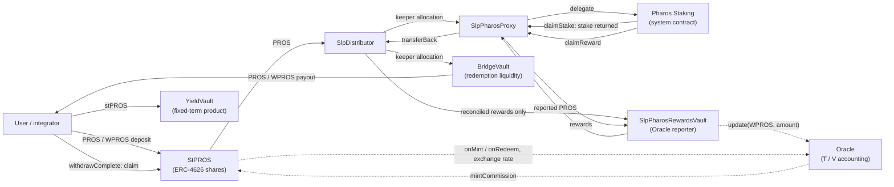

# Faroo stPROS

stPROS is a liquid staking token for the Pharos network.

- Users deposit native **PROS** or wrapped **WPROS** and receive **stPROS**, an ERC-20 / ERC-4626 share token.
- Each stPROS share is a claim on a pro-rata part of the PROS accounted for by the protocol.
- Deposited PROS is allocated to Pharos staking through the SLP (staking liquidity provider) layer.
- Staking rewards are reported to an on-chain Oracle. Each accepted report raises the PROS value of every share.
- Redemption is a queued request. Users claim PROS or WPROS once the waiting period has elapsed **and** redemption
  liquidity is available.
- stPROS is a standard token. Other DeFi protocols can hold it, transfer it and build on it.

stPROS does not guarantee principal, a fixed return, an APR or a redemption date. The share value moves only with the
yield reports the Oracle accepts, within on-chain limits.

## Key features

| Feature | What it means |
|---|---|
| ERC-20 / ERC-4626 | stPROS follows ERC-4626 with WPROS as the asset. ERC-4626 `withdraw` / `redeem` **create a redemption request**; they do not pay out immediately |
| Native PROS deposits | `depositWithPROS()` takes PROS as `msg.value` and mints stPROS to the caller |
| WPROS deposits | `deposit` / `mint` take WPROS after an ERC-20 approval |
| Queue-based redemptions | Each request burns its shares, fixes its PROS amount and joins a global first-in, first-out queue. A request becomes claimable after its waiting period, once redemption liquidity covers its queue position |
| Oracle share accounting | The Oracle tracks pooled PROS (`T`) and stPROS supply (`V`). The exchange rate is `T / V` |
| SLP capital allocation | Deposits go to the SlpDistributor. A keeper allocates them only to whitelisted destinations: the staking contracts and the redemption vault |
| Yield reporting and commission | One authorized reporter adds staking rewards to `T`, bounded by an APR ceiling, an absolute cap and a minimum interval. The protocol commission is charged on each accepted report and minted as new stPROS shares to the Treasury |
| Timelock governance | Every core contract and the proxy admin are owned by an OpenZeppelin TimelockController. A separate guardian can pause but not unpause |
| YieldVault | A separate fixed-term vault product that accepts stPROS as its asset. It is not an stPROS deposit route |

## Architecture overview

Solid arrows move assets. Dotted arrows are calls that change accounting or read state without moving assets.



The SlpDistributor → RewardsVault route is for reconciled reward funds only, never user principal; see
[SLP staking](docs/SLP-STAKING.md). [Architecture](docs/ARCHITECTURE.md) explains each contract and flow.

## Mainnet deployment

**Pharos Mainnet, chainId 1672. Release V4, executed on 2026-10-21** (upgrade transaction `0xac1fd830…f31e1b`, block
20,813,316). Addresses were verified at block 20,814,599; getters were re-read at block 20,815,667.

Integrate with the **proxy** address. Never call an implementation address: implementations hold no protocol state.

| Contract | Proxy (use this) | Implementation | ABI |
|---|---|---|---|
| StPROS | `0x6b0a44c64190279f7034b77c13a566e914fe5ec4` | `0xfd59860894e01773e9780b0d1dfae4ca2b56708d` | [`v4/StPROS.json`](deployments/mainnet/v4/StPROS.json) |
| Oracle | `0x051713fd66845a13bf23baca008c5c22c27ccb58` | `0x09c5ec5eb4e717c3c472d8c89812b7fad32929b5` | [`v4/Oracle.json`](deployments/mainnet/v4/Oracle.json) |
| BridgeVault | `0xf1df1cb080256f48e8702c24149136e4a6dec25e` | `0xa7d36cb9da47ba5123f9070fba4bb5239c58387e` | [`v4/BridgeVault.json`](deployments/mainnet/v4/BridgeVault.json) |
| SlpDistributor | `0xf772b375f93650f798bf724ce7a9a45c9e7a579f` | `0x05a224a9cdd84cfca21866ae50fa0cd663e3752f` | [`v4/SlpDistributor.json`](deployments/mainnet/v4/SlpDistributor.json) |
| YieldVaultFactory | `0xc9fb7dc52b0fb92c417d481442d2641637483881` | `0xfe34322dcd367b6cc3067a034e8f64b488bfbae9` | [`v4/YieldVaultFactory.json`](deployments/mainnet/v4/YieldVaultFactory.json) |
| YieldVault 001 | `0x36f3d19dda7ed1428e3014ae6f2a75d70393b7e6` (beacon proxy) | `0xd42fef079a694fc3f6259a614ae271cba2d5ee65` (via beacon `0x8618bfb59de57c6bff52638bf0c56f04cc58ed88`) | [`v4/YieldVault.json`](deployments/mainnet/v4/YieldVault.json) |

| Governance and asset | Address |
|---|---|
| TimelockController | `0xc30db0543412c6881a543390d2c21fbbff42805b` |
| ProxyAdmin (OpenZeppelin v4, owned by the Timelock) | `0x4238ea4adfa2bd6a5fc9b5e245dc1900cf0258aa` |
| WPROS | `0x52c48d4213107b20bc583832b0d951fb9ca8f0b0` |

The authoritative source is [`deployments/mainnet/v4/addresses.json`](deployments/mainnet/v4/addresses.json). The
machine-readable index is [`deployments/registry.json`](deployments/registry.json). Governance accounts, the SLP layer
and the out-of-scope historical contracts are listed in [deployments](deployments/README.md) and
[governance](docs/GOVERNANCE.md).

## Getting started

| You want to | Read |
|---|---|
| Integrate stPROS: deposits, redemption requests, claims, events | [docs/INTEGRATION.md](docs/INTEGRATION.md) |
| Understand the contracts and their asset flows | [docs/ARCHITECTURE.md](docs/ARCHITECTURE.md) |
| Understand Pharos staking, rewards and the SLP layer | [docs/SLP-STAKING.md](docs/SLP-STAKING.md) |
| Look up current parameters and who can change them | [docs/PARAMETERS.md](docs/PARAMETERS.md) |
| Review roles, the Timelock and emergency controls | [docs/GOVERNANCE.md](docs/GOVERNANCE.md) |
| Find addresses, ABIs, testnet and historical records | [deployments/README.md](deployments/README.md) |
| Build, test and work on the repository | [docs/TOOLCHAIN.md](docs/TOOLCHAIN.md), [docs/CODE_MAP.md](docs/CODE_MAP.md) |
| Read the protocol policy and the upgrade design | [docs/SPEC.md](docs/SPEC.md), [docs/UPGRADES.md](docs/UPGRADES.md), [docs/RECOVERY.md](docs/RECOVERY.md) |

### Local development

The toolchain uses Python, a pinned native solc binary and Foundry. Solidity dependencies are vendored byte for byte,
so nothing needs to be installed from a package manager.

Every command runs inside an isolated export: an allowlisted copy of the tree without environment files. Create the
export under the project's temporary directory, `/Volumes/project/tmp`. The destination must not exist yet.

```sh
dest=$(tools/verify/export.sh /Volumes/project/tmp/faroo-export-$(date +%s) | tail -1)
tools/verify/run.sh "$dest" python3 -m unittest discover -s tests/toolchain -p 'test_*.py' -v
```

**Build status of the current tree.** The protected build (`tools/ci/canonical.py`) covers 12 production sources whose
artifacts are fixed by `tools/ci/r4-reference.json`. `contracts/` currently also contains two SLP-layer sources,
`SlpPharosProxy.sol` and `SlpPharosRewardsVault.sol`, whose dependencies are not vendored yet. With them present the
protected build is expected to stop with `production source inventory drift`, and some snapshot checks fail. `make build`
is therefore not a working quick start for the current tree. Read
[the toolchain note](docs/TOOLCHAIN.md#sources-outside-the-canonical-build) before building.

The `make` targets also create their export in the default system temporary directory; for this project use the
explicit form above. Foundry binaries load environment files from their working directory and its parents: run them only
through `tools/verify/run.sh` inside an export ([toolchain rules](docs/TOOLCHAIN.md#repository-rules)). The repository tooling prepares and verifies
unsigned upgrade plans. It cannot sign, send or deploy transactions.

## Security

- Smart contracts carry risk, including the risk of total loss. The Oracle, the keeper, the reporter, the SLP
  destinations and governance are trusted roles with bounded powers; [governance](docs/GOVERNANCE.md) and
  [SLP staking](docs/SLP-STAKING.md) describe them.
- The protocol commission is charged on every amount the Oracle accepts as a yield report. The contracts cannot tell
  whether a reported amount is real reward. If non-reward funds are reported, they raise the share value and are
  charged commission as well ([SLP staking](docs/SLP-STAKING.md#known-risk-principal-reported-as-yield)).

### Audit scope

| Scope | Contracts | Status |
|---|---|---|
| Core audit package | The 12 core files at frozen commit `a110037`: StPROS, VToken, Oracle, BridgeVault, SlpDistributor, YieldVault, YieldVaultFactory, GuardedOwnableUpgradeable, MigrationGuard, ReleaseAssertions, IOracle, IWPROS | Frozen audit package prepared for external audit. This repository records neither its delivery to an auditor nor a completed external audit report |
| SLP Extension | `SlpPharosProxy`, `SlpPharosRewardsVault` | Not in the `a110037` package. The owner reports that the ABDK statement of work lists it as a separate scope; that document is not stored here. **These two contracts must not be considered externally audited** |

Internal reviews are not an external audit. The SLP contracts are deployed and administered outside this repository's
release process ([deployment status](docs/SLP-STAKING.md#deployment-status)).

## License

GPL-3.0, as declared in each source file.
