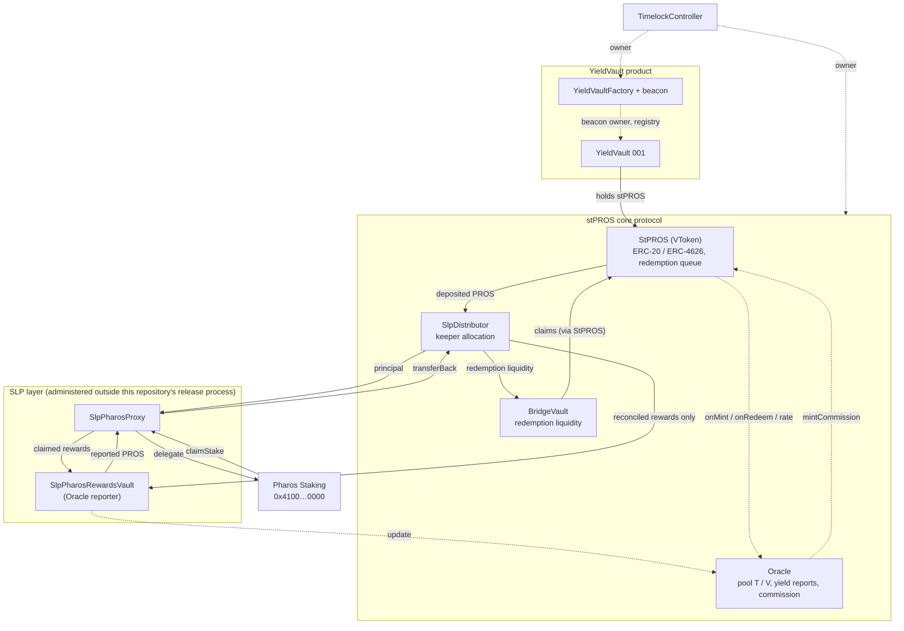
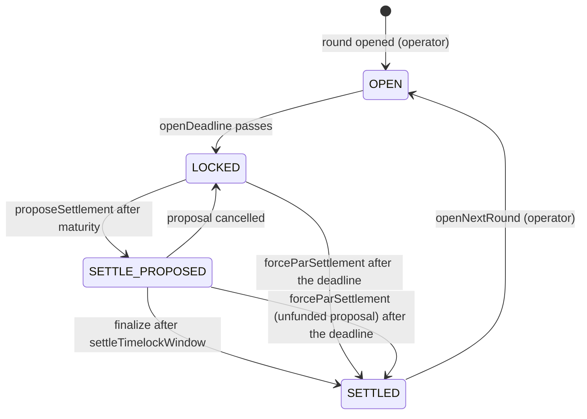
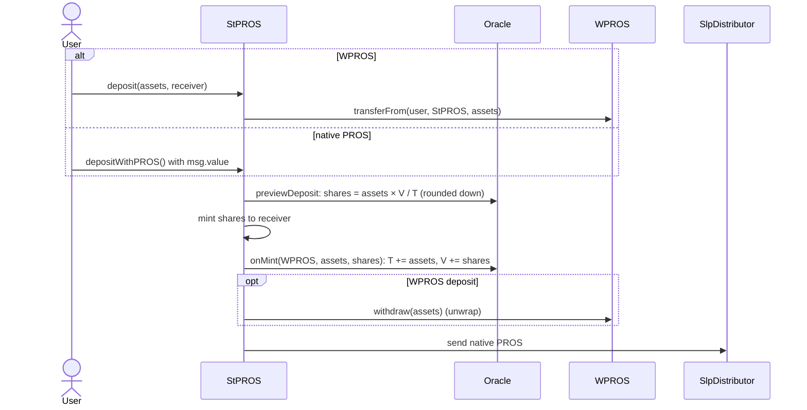
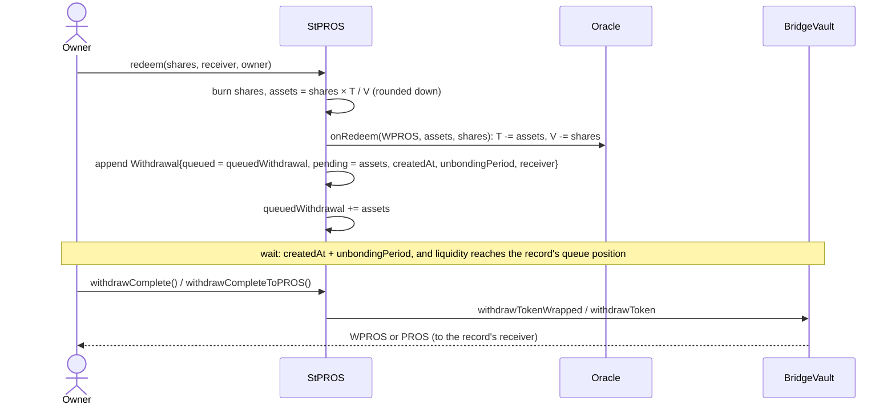
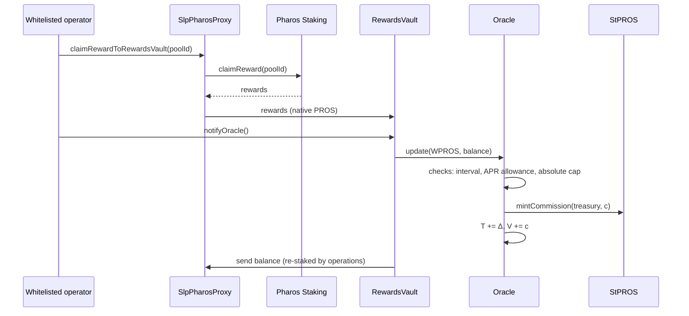

# Architecture

## Purpose

This document explains what each Faroo contract does and how PROS, WPROS and stPROS move between them. It describes the
**V4 implementation deployed on Pharos Mainnet on 2026-10-21**. Addresses are in the
[README](../README.md#mainnet-deployment) and [`deployments/registry.json`](../deployments/registry.json). Parameter
values are in [PARAMETERS.md](PARAMETERS.md).

Two products live in this repository and must not be confused:

| Product | Contracts | Entry point for users |
|---|---|---|
| **stPROS liquid staking** (core protocol) | StPROS / VToken, Oracle, SlpDistributor, BridgeVault, the SLP layer | StPROS: `deposit`, `mint`, `depositWithPROS`, `withdraw`, `redeem`, `withdrawComplete*` |
| **YieldVault** (fixed-term product) | YieldVaultFactory, YieldVault (beacon proxies) | Each vault: ERC-4626 over **stPROS**, open only in its subscription window |

A YieldVault deposit takes stPROS that the user already holds. It never mints stPROS and is not a route into staking.

## System map

Solid arrows move assets. Dotted arrows are calls that change accounting or only read.

## Contracts

### StPROS / VToken

`StPROS` (`contracts/StPROS.sol`) extends `VToken` (`contracts/VToken.sol`), an OpenZeppelin `ERC4626Upgradeable` whose
asset is WPROS.

- **Deposits.** `deposit` / `mint` pull WPROS, mint shares, call `Oracle.onMint`, unwrap the WPROS and send native PROS
  to `slp()`, the SlpDistributor. `depositWithPROS()` does the same from `msg.value` and mints to `msg.sender`.
  StPROS keeps no deposit balance.
- **Conversions.** `convertToShares` / `convertToAssets`, all `preview*` functions and `totalAssets()` are computed by
  the Oracle from its pool `T` / `V`, not from a token balance.
- **Redemption requests.** ERC-4626 `withdraw` / `redeem` burn the owner's shares, call `Oracle.onRedeem` and append a
  `Withdrawal` record to the owner's queue. No asset leaves at this point.
- **Claims.** `withdrawComplete*` pay matured, funded records from the BridgeVault: WPROS for `withdrawComplete`,
  native PROS for `withdrawCompleteToPROS`.
- **Commission.** `mintCommission` can be called only by the Oracle; it mints commission shares to the Treasury.
- **Controls.** Owner (the Timelock) setters, guardian pause and owner-only unpause come from
  `GuardedOwnableUpgradeable`. Claims are not blocked by a StPROS pause; they depend on the BridgeVault (below).

### Oracle

`Oracle` (`contracts/Oracle.sol`) holds the share accounting of each asset pool. Mainnet has one pool: WPROS ↔ stPROS.

| Symbol | Storage | Meaning |
|---|---|---|
| `T` | `poolInfo(WPROS).tokenAmount` | PROS accounted for by the pool: deposits, minus redemption requests, plus accepted yield |
| `V` | `poolInfo(WPROS).vTokenAmount` | stPROS shares accounted for by the pool, including commission shares |

**Exchange rate.** Assets per share is `T / V`. The functions are `getVTokenAmountByToken(token, assets, rounding)` =
`assets × V / T` and `getTokenAmountByVToken(token, shares, rounding)` = `shares × T / V`. An empty pool converts 1:1.
Rounding follows ERC-4626: deposits and redemptions round down for the user; `mint` and `withdraw` round up the side
the user pays.

**Accounting events.**

| Event in the protocol | Effect on T | Effect on V |
|---|---|---|
| Deposit of `a` PROS for `s` shares (`onMint`) | `T += a` | `V += s` |
| Redemption request of `s` shares for `a` PROS (`onRedeem`) | `T -= a` | `V -= s` |
| Accepted yield report `Δ` (`update`) | `T += Δ` | `V += c` (commission shares) |
| Governance compare-and-set correction (`setTokenAmount`) | `T = newT` if `T == expectedOldT` | unchanged |

**Yield reports.** Only the configured reporter (`Oracle.slp()`) can call `update(WPROS, Δ)`. A report is accepted only
when all of these hold:

1. the Oracle is not paused, `0 < Δ ≤ maxUpdateAmount` and the pool has shares;
2. at least `updateInterval` seconds have passed since `lastUpdateAt(WPROS)`;
3. `Δ ≤ T × maxAprPpm × min(elapsed, 7 days) / (365 days × 1,000,000)`.

**Commission.** With rate `r` = `commissionRatePpm` / 1,000,000, the commission in PROS is `f = floor(Δ × r)`. It is
paid as `c = floor(f × V / (T + Δ − f))` new shares, minted to `commissionAccount` through `StPROS.mintCommission`. After
the report the Treasury's new shares are worth `f`, and all other holders share `Δ − f`. Deposits and redemption
requests are not charged. Commission applies to whatever amount the Oracle accepts as a report: the Oracle cannot tell
reward from other funds, so non-reward funds reported by mistake are charged as well
([SLP-STAKING.md](SLP-STAKING.md#known-risk-principal-reported-as-yield)). Values:
[PARAMETERS.md](PARAMETERS.md#oracle-and-yield-reporting).

`canUpdate(token, amount)` previews these checks. It is advisory: a report it accepts can still revert, for example when
commission minting fails while StPROS is paused.

The Oracle has no knowledge of where PROS physically is. `T` is an accounting figure that the protocol keeps consistent
with deposits, redemptions and reported rewards. The physical PROS can be in the SlpDistributor, in staking, in transit
or in the BridgeVault.

### BridgeVault

`BridgeVault` (`contracts/BridgeVault.sol`) holds the liquidity that pays redemption claims.

- It registers StPROS for the WPROS asset with the wrapped-native flag (`weth()` = WPROS). Its WPROS balance for
  accounting is its **native PROS balance**: `getBalance(WPROS)` returns `address(this).balance`.
- It accepts native PROS from any sender (`receive()`); the keeper sends liquidity through the SlpDistributor.
- Only a registered vToken (StPROS) can pay out, and only its own asset, through `withdrawToken` (native, with WPROS
  fallback when the receiver rejects native) or `withdrawTokenWrapped` (wraps and sends WPROS). Both are blocked while
  the BridgeVault is paused.
- WPROS donated to the vault does not count as liquidity until anyone calls `unwrapWrapped()`.
- `emergencyWithdraw` is owner-only (the Timelock).

### SlpDistributor

`SlpDistributor` (`contracts/SlpDistributor.sol`) is the `slp()` of StPROS: every deposit's PROS arrives here.

- `distribute((address slp, uint256 amount)[])` is callable only by the `keeper`, only while unpaused, and only to
  whitelisted addresses. It reverts if the total exceeds the balance or a transfer fails.
- The owner (the Timelock) manages the whitelist (`setSlps`) and the keeper (`setKeeper`). A whitelist entry must be a
  contract.
- The distributor does not distinguish principal from rewards. Funds returned from staking land here too.

Mainnet whitelist order: SLP execution contract #1, SLP execution contract #2, the BridgeVault, the RewardsVault.
[SLP-STAKING.md](SLP-STAKING.md) explains which funds may go to which destination.

### SlpPharosProxy

`SlpPharosProxy` (`contracts/SlpPharosProxy.sol`) delegates PROS to Pharos validator pools through the Pharos Staking
system contract at `0x4100000000000000000000000000000000000000`: bond, unbond, claim stake, claim and settle rewards.
Returned stake leaves through `transferBack` to its configured return address. On mainnet the return address
(`getBridgeVault()`) is the **SlpDistributor**. Rewards go to the RewardsVault. Details:
[SLP-STAKING.md](SLP-STAKING.md).

### SlpPharosRewardsVault

`SlpPharosRewardsVault` (`contracts/SlpPharosRewardsVault.sol`) is the mainnet Oracle reporter. `notifyOracle()` reports
its **entire native balance** to `Oracle.update` and forwards that amount to its SlpPharosProxy. The contract does not
know whether its balance is reward; operations must keep principal out of it
([SLP-STAKING.md](SLP-STAKING.md#security-and-trust-assumptions)).

The two SLP contracts are not part of the canonical V4 build or of the `a110037` core audit package, and are not
externally audited ([audit scope](../README.md#audit-scope)). Their mainnet instances are
upgradeable proxies with their own administrator. See [deployment status](SLP-STAKING.md#deployment-status).

### YieldVaultFactory and YieldVault

`YieldVaultFactory` (`contracts/YieldVaultFactory.sol`) owns the `UpgradeableBeacon` of its vaults and records them
(`isFactoryVault`, `getAllProxies`). Only its owner, the Timelock, can create vaults, whitelist counterparties, set the
approved performance fee for new rounds, emergency-cancel, retire vaults, close creation or upgrade the beacon.

`YieldVault` (`contracts/YieldVault.sol`) is an ERC-4626 vault over **stPROS** that runs in rounds:

- Deposits are accepted only in OPEN, between `openedAt` and `openDeadline`, within the round and per-address caps.
  Redemptions are accepted in OPEN (before the deadline) and SETTLED, and are paid immediately in stPROS from the
  vault. YieldVault redemptions are not queued.
- PROFIT settlement adds externally funded stPROS to `totalManagedAssets`, minus the round's performance fee. LOSS
  settlement pays up to `maxLossBps` of managed assets to the vault's counterparty, and only the Timelock can propose
  it.
- After `settlementDeadline() = openDeadline + lockDuration + 30 days`, anyone can force a par settlement of a round
  that is still LOCKED or has an unfunded proposal. A forced par settlement applies neither profit nor loss: a LOSS
  that was not proposed in time is not paid to the counterparty, and an unfunded PROFIT proposal pays holders nothing.
  Funded PROFIT, zero PROFIT and proposed LOSS settlements stay binding; they settle through `finalize`, which needs
  the Factory unpaused.
- The Factory owner (the Timelock) can also `emergencyCancel` an unsettled round (back to SETTLED at principal) or
  `retireVault` a vault permanently. Both refund a funded PROFIT proposal; after retirement, redemptions stay available
  and no new round can open. `closeCreation()` permanently stops new vaults from the Factory.
- Vault shares use 24 decimals (an ERC-4626 decimals offset of 6 over stPROS's 18).

Authenticate a vault with `YieldVaultFactory.isFactoryVault(vault)` on the official Factory. A vault created by
another factory is not an official Faroo vault.

### Governance: Timelock, ProxyAdmin, guardian

- The core proxies (StPROS, Oracle, BridgeVault, SlpDistributor, YieldVaultFactory) are OpenZeppelin v4
  `TransparentUpgradeableProxy`s administered by one shared OpenZeppelin v4 `ProxyAdmin`.
- The `TimelockController` owns the ProxyAdmin, every core contract and the Factory. The Factory owns the vault
  beacon, so beacon upgrades also go through the Timelock.
- Each core contract has a `guardian()` that may `pause()`; only the owner may `unpause()`. `renounceOwnership` is
  disabled and ownership transfers are two-step.

Roles and their limits: [GOVERNANCE.md](GOVERNANCE.md).

## Flows

### Deposit

The whole deposit is one transaction. It reverts if StPROS or the Oracle is paused, or if the transfer to the
SlpDistributor fails.

### Redemption request and claim

- **Fixed amount.** The PROS amount is fixed when the request is made. Later yield reports do not change it, and the
  request earns no further yield.
- **Waiting period.** Each record stores the `unbondingPeriod` in force when it was created. A later change of the
  global setting does not affect existing records.
- **Global FIFO.** Each record stores `queued`, the cumulative requested amount before it. Let `available` =
  `BridgeVault.getBalance(WPROS) + completedWithdrawal`, as returned by `getTotalBalance()`. A matured record can be paid
  `min(available − queued, pending)`. Earlier requests are therefore served first, across all users.
- **Per-owner order.** A claim walks the caller's own records in order and stops at the first record that is not yet
  matured or not yet funded. A record can be paid in part.
- **Receiver.** A request whose receiver equals the owner stores no receiver, and the claim pays the claimer or the
  receiver passed to `withdrawComplete(receiver)`. A request with a different receiver is bound to it.
- **Outstanding records** per owner are capped by `maxWithdrawCount`.

Funding the queue is an operational task. The keeper moves PROS to the BridgeVault through the SlpDistributor. Staked
PROS first needs to be unbonded on Pharos ([SLP-STAKING.md](SLP-STAKING.md#principal-flow)).

### Yield report and commission

After a report, every share is worth more PROS. Reported PROS is sent back to the SlpPharosProxy and stays in the
protocol. The value is paid out only when holders redeem.

## Properties and limits

| Topic | Behaviour |
|---|---|
| Value of a share | `T / V`, changed only by accepted yield reports and governance corrections. Deposits and redemptions keep it constant up to rounding |
| Redemption timing | Not guaranteed. It needs the record's waiting period **and** BridgeVault liquidity above the record's queue position |
| Liquidity | The Oracle accounts for PROS that may be staked. Redemption liquidity depends on the keeper and on Pharos unbonding |
| Pauses | A StPROS or Oracle pause stops deposits and new requests. A BridgeVault pause stops claim payouts. Unpause is Timelock-only |
| Upgrades | Every core implementation and the vault beacon can be upgraded only by the Timelock |
| Reporter trust | The reporter can add at most the bounded allowance per interval. It cannot reduce `T` or mint shares to itself |

Known risks and their owner decisions are recorded in the research repository. The parts that matter to integrators
are in [INTEGRATION.md](INTEGRATION.md#risks-for-integrators).
