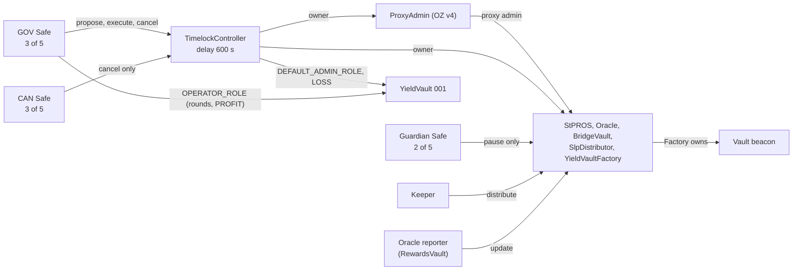

# Governance

## Purpose

This document explains who controls the Faroo contracts on Pharos Mainnet, what each role can and cannot do, how
governance transactions are executed, and which limits apply. It describes the **state after the V4 upgrade of
2026-10-21**, read from chain at block 20,815,667 unless another block is given. Current parameter values are in
[PARAMETERS.md](PARAMETERS.md); emergency and custody procedures are in [RECOVERY.md](RECOVERY.md); the procedure for
future upgrades is in [UPGRADES.md](UPGRADES.md).

Governance is not trustless. The Timelock and the accounts behind it can upgrade every core contract, change
parameters and move BridgeVault custody. The delay and the separate canceller make changes visible before they apply;
they do not remove the trust.

## Current governance



### Roles

Addresses are authoritative in [`deployments/mainnet/v4/addresses.json`](../deployments/mainnet/v4/addresses.json).

| Role | Address | Permissions | Can be changed by | Restrictions |
|---|---|---|---|---|
| **GOV Safe** (3 of 5, Safe 1.4.1) | `0x3658e00f5ddb9fa0c7e9820e8d16c3c17eab73ca` | Timelock `PROPOSER_ROLE`, `EXECUTOR_ROLE`, `CANCELLER_ROLE`. YieldVault 001 `OPERATOR_ROLE` (the OPS role) | Timelock role changes: the Timelock itself. Vault role: the Timelock (`DEFAULT_ADMIN_ROLE`). Signers and threshold: the Safe itself | Every protocol change it proposes waits the Timelock delay. No direct ownership of core contracts |
| **CAN Safe** (3 of 5, Safe 1.5.0) | `0xb3c8a7f291e128e5d1ff3e2aa09fe8a9b38fce76` | Timelock `CANCELLER_ROLE` only | The Timelock itself | Cannot propose, execute, upgrade, pause or move assets |
| **Guardian Safe** (2 of 5, Safe 1.5.0) | `0xa046988889871c6c7abc69e63cccf9adb3e57ef5` | `pause()` on StPROS, Oracle, BridgeVault, SlpDistributor and YieldVaultFactory (`guardian()`) | Timelock: `setGuardian(address)` on each contract | Cannot unpause, upgrade, change parameters or move assets. No Timelock role |
| **TimelockController** (OZ 5.6.1) | `0xc30db0543412c6881a543390d2c21fbbff42805b` | Owner of the ProxyAdmin, StPROS, Oracle, BridgeVault, SlpDistributor and YieldVaultFactory. `DEFAULT_ADMIN_ROLE` of YieldVault 001. The only LOSS authority for vaults. Its own admin | Itself: role and delay changes are Timelock operations | Acts only through operations proposed by GOV and executed after the delay. No open executor role |
| **ProxyAdmin** (OZ v4) | `0x4238ea4adfa2bd6a5fc9b5e245dc1900cf0258aa` | Admin of the five core proxies: `upgrade`, `upgradeAndCall` | Owner: the Timelock | Every call comes from the Timelock |
| **YieldVaultFactory owner** | The Timelock | Create vaults, whitelist counterparties, set the approved performance fee, upgrade the vault beacon, emergency-cancel or retire vaults, close creation | — | Through the Timelock only |
| **YieldVault OPERATOR_ROLE** (OPS) | GOV Safe | `openNextRound`, `extendOpenPeriod`, PROFIT `proposeSettlement`, cancel a non-LOSS proposal | Timelock (`DEFAULT_ADMIN_ROLE` of the vault) | Cannot propose or replace a LOSS. Acts directly, without the Timelock delay |
| **Keeper** | `0x8736e68f37c1156e09445ac2d395a139e58fcab4` | `SlpDistributor.distribute` to whitelisted destinations. Also `WHITELIST_ROLE` on the SLP contracts and the RewardsVault | SlpDistributor: Timelock (`setKeeper`). SLP roles: the SLP administrator | Cannot change the whitelist. See [SLP-STAKING.md](SLP-STAKING.md#keeper-responsibilities) |
| **Oracle reporter** | `0xd0c44d3079e97ff285dd7a3e4e0246320a9487e5` (SlpPharosRewardsVault) | `Oracle.update`: add bounded yield | Timelock: `Oracle.setSlp(address)` | Bounded by the interval, APR allowance and absolute cap ([PARAMETERS.md](PARAMETERS.md#oracle-and-yield-reporting)) |
| **Treasury** | `0x3754fd5ec997c07ca528bb0bdcb0b4f5b93605df` | Receives commission shares. Counterparty and fee recipient of YieldVault 001 | Commission recipient: Timelock (`setCommissionConfig`). Vault counterparty: fixed at vault creation | No protocol permissions. An account without contract code at block 20,815,667 |
| **SLP administrator** | `0x976cf43c894ba43cf096da8c1427f6a51b724bb9` | `DEFAULT_ADMIN_ROLE` of both SLP execution contracts and the RewardsVault; owner of their ProxyAdmin `0x480eb384681777bf21e72b8c8538987c2801b4b7` | Itself | **Outside the Timelock.** A single account without contract code (block 20,817,024). See [SLP-STAKING.md](SLP-STAKING.md#changeable-by-governance-or-by-the-slp-administrator) |

### Timelock role matrix

| Timelock role | Holder | Not held by |
|---|---|---|
| `DEFAULT_ADMIN_ROLE` | The Timelock itself | GOV, CAN, Guardian |
| `PROPOSER_ROLE` | GOV Safe | CAN, Guardian, the Timelock, `address(0)` |
| `EXECUTOR_ROLE` | GOV Safe | CAN, Guardian, the Timelock, `address(0)` (no open executor) |
| `CANCELLER_ROLE` | GOV Safe and CAN Safe | Guardian, the Timelock, `address(0)` |

The table is the `hasRole` result for these accounts at block 20,815,667. The Timelock was deployed with a temporary
deployer admin, which granted the CAN role and then renounced `DEFAULT_ADMIN_ROLE`; the pre-deployment verification
checked the resulting roles from the Timelock's events and `hasRole`. OpenZeppelin `AccessControl` is not enumerable, so
grants to other accounts are visible only through `RoleGranted` / `RoleRevoked` events. Monitor them.

### Who can do what

| Action | Who | How |
|---|---|---|
| Upgrade StPROS, Oracle, BridgeVault, SlpDistributor or YieldVaultFactory | Timelock | `ProxyAdmin.upgrade` / `upgradeAndCall`, proposed by GOV, executed by GOV after the delay |
| Upgrade the YieldVault implementation | Timelock | `YieldVaultFactory.upgradeBeaconTo` |
| Change Oracle parameters, reporter, commission, or correct `T` | Timelock | `setMaxAprPpm`, `setUpdateLimits`, `setCommissionConfig`, `setSlp`, `setTokenAmount` |
| Change the waiting period or the record limit | Timelock | `StPROS.setUnbondingPeriod`, `setMaxWithdrawCount` (new requests only) |
| Change the SlpDistributor whitelist or keeper | Timelock | `setSlps`, `setKeeper` |
| Move BridgeVault custody | Timelock | `BridgeVault.emergencyWithdraw` |
| Pause a core contract | Guardian Safe, or the Timelock as owner | `pause()` |
| Unpause | Timelock only | `unpause()` |
| Replace the guardian | Timelock | `setGuardian` per contract |
| Open or extend vault rounds; propose or cancel PROFIT | OPS (GOV Safe), directly | YieldVault functions |
| Propose, replace or cancel a LOSS | Timelock | YieldVault `proposeSettlement(LOSS, …)` from the Timelock |
| Fund a PROFIT proposal, finalize a settlement, force a par settlement after the deadline | Anyone | `fundProfit`, `finalize`, `forceParSettlement` |
| Propose and execute Timelock operations | GOV Safe | `schedule` / `scheduleBatch`, then `execute` / `executeBatch` |
| Cancel a pending Timelock operation | GOV Safe or CAN Safe | `cancel(id)` |
| Change SLP pool lists, operators, return addresses, implementations | SLP administrator | SLP contract roles and their ProxyAdmin. **Not part of the Timelock system** |

### Two-stage Safe and Timelock execution

Every **Timelock-executed governance operation** takes two GOV Safe transactions. This covers every action whose caller
must be the owner of a core contract, the ProxyAdmin or the Factory, and every Timelock-only vault action (LOSS):
upgrades, parameter and address setters, `unpause`, guardian replacement, custody recovery and Timelock role or delay
changes.

1. **Schedule.** GOV signers (3 of 5) execute a Safe transaction that calls `scheduleBatch(targets, values, payloads,
   predecessor, salt, delay)` on the Timelock. The operation ID is the hash of all those fields. `CallScheduled` events
   publish the exact calls.
2. **Wait.** The operation can be executed only after `delay ≥ getMinDelay()` seconds. During that time the GOV Safe or
   the CAN Safe can cancel it.
3. **Execute.** GOV signers execute a second Safe transaction calling `executeBatch` with identical fields. The batch is
   atomic: if one call fails, nothing applies.

Anyone can watch `CallScheduled`, `CallExecuted` and `Cancelled` on the Timelock to see changes before they apply.

Rules for every Timelock operation:
- A scheduled operation is never edited. A different payload, salt or predecessor is a new operation ID with a new
  review and the full delay; the old ID is cancelled separately.
- Cancelling or replacing a proposer does not remove the operations it already scheduled. Track every Waiting and Ready
  operation until it is executed or cancelled.
- Governance calls are prepared as reviewed, unsigned calldata. The repository tooling cannot sign or send
  transactions ([UPGRADES.md](UPGRADES.md)).

### Actions executed directly, without the Timelock

These permissions act immediately, in a single transaction by their holder. They do not pass through the Timelock and
do not appear in its events.

| Action | Holder | Limits |
|---|---|---|
| `pause()` on a core contract | Guardian Safe (also the owner, through the Timelock) | Stops the paused contract's guarded functions; cannot unpause, change parameters or move assets |
| Vault round operations: `openNextRound`, `extendOpenPeriod`, PROFIT `proposeSettlement`, cancelling a non-LOSS proposal | OPS (`OPERATOR_ROLE`, currently the GOV Safe through its own Safe transactions) | Within the vault's constants and the Factory-approved fee; no LOSS authority |
| `SlpDistributor.distribute` | Keeper | Only to whitelisted destinations, from the distributor's balance, while unpaused |
| `Oracle.update` (through `notifyOracle`) | Oracle reporter and its operators | Bounded by the interval, APR allowance and absolute cap |
| SLP pool, operator and return-address management | SLP administrator and `WHITELIST_ROLE` holders | Outside the Timelock system ([SLP-STAKING.md](SLP-STAKING.md)) |
| Deposits, redemption requests, claims, vault deposits and redemptions, `fundProfit`, `finalize`, `forceParSettlement`, `unwrapWrapped` | Any user, under each function's own conditions | No governance authority |

### Timelock delay

The current delay is **600 seconds**, chosen by the owner for the V4 configuration phase. During this phase every
governance operation, including an upgrade, needs only 600 seconds of notice. This is a disclosed governance risk.

The owner's policy is to raise the delay to **86,400 seconds (24 hours)** once configuration is complete. That needs a
separate owner authorization and a Timelock operation calling `updateDelay(86400)` on the Timelock itself, scheduled
with the current delay. After it executes, `getMinDelay()` must return 86,400 and no operation scheduled with the short
delay may remain pending. Nothing switches automatically, and no Safe or account can change the delay outside the
Timelock. At block 20,815,667, `getMinDelay()` returned 600.

### Role separation

Enforced by the contracts:
- A YieldVault's `DEFAULT_ADMIN_ROLE` can be granted only to the Factory's Timelock.
- A YieldVault's `OPERATOR_ROLE` cannot be granted to the zero address, the Timelock, the vault's counterparty or its
  fee recipient.
- On the core contracts the guardian can only pause; `unpause`, `setGuardian` and every setter are owner-only.
  `renounceOwnership` is disabled and ownership transfers are two-step.

Owner policy for any change of role holders, checked by the release tooling for a governed release:
- GOV and CAN are different accounts; the Guardian is never GOV; OPS is never CAN or the Guardian; no role is the
  Timelock. GOV may also be OPS, and CAN may also be the Guardian; neither is required.
- The Oracle reporter and the keeper are never GOV, CAN or the Timelock.
- CAN and the Guardian hold no proposer, executor, upgrade, unpause, vault-operation or asset authority.

Safe internals (owners, threshold, modules, guard, nonce) are managed by each Safe's owners and are not checked by the
release tooling.

### Signer overlap

Safe `getOwners()` at block 20,815,667:
- the CAN Safe and the Guardian Safe have the same five owners;
- the GOV Safe shares two owners with them;
- one of those shared owners, `0x976c…4bb9`, is also the SLP administrator.

The roles are separated at contract level, but they are not held by fully independent signer groups.

## LOSS contingency planning

A YieldVault LOSS settlement pays up to the round's `maxLossBps` of managed assets to the counterparty. Only the
Timelock can propose, replace or cancel it, so a LOSS always needs a scheduled Timelock operation. This section is the
procedure for preparing one. Recovery of a failed or stale LOSS is covered by the same rules.

**Why two paths.** A Guardian pause of the Factory can make a scheduled LOSS miss the fixed proposal cutoff, and so
indirectly change who bears the round outcome. The Guardian cannot move custody or change NAV directly. The mitigation
below is operational, with residual timing and economic risk; it is not a contract-level fix. The effect can reach the
round's loss cap (at most 50 %); it is not bounded by the length of an outage.

For one reviewed LOSS amount and round, prepare and independently schedule both paths:

| Path | Exact ordered target calls | Required execution state |
|---|---|---|
| A | Vault `proposeSettlement(LOSS, approvedAmount, address(0))` | Factory unpaused |
| B | Factory `setGuardian(reviewedReplacementGuardian)`; Factory `unpause()`; same Vault LOSS call | Factory paused; one atomic Timelock batch |

B rolls back in full if any call fails, including `unpause()` when already unpaused. A fails while paused. Neither path
works in both pause states. Replacing the Guardian takes effect only when B succeeds; approve the exact replacement
independently. No tooling may invent a Guardian, Safe, signer approval, amount or new round terms.

**Timing.** A LOSS operation may be scheduled before maturity. The Timelock delay runs from scheduling, the vault
proposal still requires maturity and the cutoff, and finalization keeps the settlement window. A LOSS round therefore
settles no earlier than `max(scheduleTime + minDelay, maturity) + settleTimelockWindow` (owner clarification of
2026-10-13). An operation that is Ready before maturity is refused (`VaultNotMatured`) until maturity and is not
consumed by that failure; CAN or GOV may cancel it at any time before execution
(`tests/security/LossSettlementTiming.t.sol`). Scheduling earlier lengthens the period in which unused operation IDs
must be tracked and cancelled.

**Scheduling window.** Compute `D = openDeadline + lockDuration + SETTLEMENT_GRACE` and
`proposalCutoff = D - settleTimelockWindow`. Schedule **both** operations no later than
`proposalCutoff - actualMinDelay - reviewedMargin`. The margin is a positive, explicitly reviewed operational input,
not a constant. Make sure maturity also leaves the margin before the cutoff. The contract accepts the exact cutoff, but
operators keep the reviewed margin rather than plan for last-second inclusion. If neither path can safely execute before
the cutoff, report **BLOCKED** and re-review; never extend `D` or silently change the amount, Guardian, calldata, salts
or operation IDs. OPS pre-emption, new pauses, unavailable signers, transaction inclusion and other state changes remain
risks. After `D`, anyone can force a par settlement of a round that has no binding proposal
([ARCHITECTURE.md](ARCHITECTURE.md#yieldvaultfactory-and-yieldvault)); a LOSS not proposed in time is then not paid.

**Preparation command.** `python3 -m tools.release.native loss contingency` is the only LOSS preparation route. It is
unsigned and read-only. Path A's single call is byte-identical to standalone
`proposeSettlement(LOSS, amount, address(0))` calldata. The command checks the current chain, approved runtimes, Factory
proxy admin and implementation, vault beacon, implementation and asset, Factory registry membership and the vault's
back-link, owners, authority getters, round terms, delay, backing and the selected operation IDs. Release mode binds the
canonical Factory, asset, beacon and ProxyAdmin to the chain registry and the Timelock to its pinned OpenZeppelin
runtime. Full runtime hashes, including the Factory's immutable binding, must be approved from known sources and
artifacts, never copied from unchecked observations. Fresh read-only state is evidence at a pinned block, not a promise
that it stays unchanged through scheduling or execution.

The command supports new paired plans for effective LOCKED, non-retired rounds only. It refuses existing proposals and
selected IDs that are already scheduled or Done, so it is a preparation check, **not** an execution-time checkpoint for
operations already scheduled. It checks only the named roles and operations, does not enumerate all role holders or
Timelock operations, does not authenticate Safes, and does not schedule, execute or cancel. A reviewed plan is valid for
at most 3,600 seconds after `reviewedAt`. Execution timing is `max(ready, maturity)` with
`ready = max(now, observed block time) + minDelay`; plans may therefore be prepared before maturity. Replacing an
existing proposal, a new unregistered Factory and other proxy topologies need separate review. All output is
`deployable: false`: actual Safe identities, signer independence, nonces and execution approvals are external
requirements.

**Paired-operation reconciliation.** After the selected path executes, **CAN may cancel the unused pending operation;
GOV keeps its canceller capability**. Verify that the selected ID is Done, the unused ID is Unset after cancellation,
and the full operation inventory matches the actual execution and cancellation receipts. The unused operation could
still replace a proposal or act on a later round: LOSS calldata has no round-index argument. A currently reverting
Ready call is not closed. Waiting and Ready both remain pending, including blocked dependencies. Keep the original
bundle; a changed payload is a new operation that needs a new review and the full delay. Reconcile and cancel every
unused LOSS operation ID before the vault opens its next round; an uncancelled ID remains executable by GOV against the
later round's managed assets (`tests/security/StaleLossOperation.t.sol`). Paired LOSS operations do not bypass the
Timelock operation inventory of a governed release ([UPGRADES.md](UPGRADES.md#timelock-operation-inventory)).

**Monitoring.** Monitor each intended or scheduled LOSS for the cutoff, the latest scheduling time, the actual delay,
Waiting / Ready / Done / cancelled status, Factory pause and the Guardian identity. Escalate before the paired scheduling
window closes, immediately on a pause near the cutoff, on a missed cancellation, or on round, amount, role, owner, code
or asset drift. Unexpected history, a changed Safe or Guardian approval, insufficient backing, revoked authority, a
stale or reorged observation or a failed execution simulation requires re-review. Recheck runtime conditions
immediately before execution, including finalization's separate pause and window dependency. A Ready operation alone is
not sufficient. Nothing in this document authorizes a mainnet or testnet transaction.

### LOSS plan input and read-only usage

Run only in an isolated export through `tools/verify/run.sh` ([TOOLCHAIN.md](TOOLCHAIN.md#commands)):

```bash
tools/verify/run.sh "$dest" python3 -m tools.release.native loss contingency --plan /absolute/path/to/reviewed-loss-plan.json --review-hash "$REVIEWED_PLAN_SHA256" --rpc "$PUBLIC_READ_ONLY_RPC"
```

The operator supplies `REVIEWED_PLAN_SHA256` and `PUBLIC_READ_ONLY_RPC` independently. No wallet client, signature or
transaction is involved. Missing proof inputs block the command. The JSON schema is `faroo-loss-contingency-v1`:

| Input fields | Reviewed meaning |
|---|---|
| `mode`, `chainId` | `simulation` or `release`; integer chain ID (release: 1672/688689) |
| `vault`, `factory`, `timelock`, `asset`, `beacon`, `factoryImplementation`, `vaultImplementation`, `proxyAdmin` | Exact lowercase nonzero approved contract identities |
| `guardian`, `replacementGuardian`, `gov`, `can`, `operator`, `counterparty`, `feeRecipient` | Exact reviewed actors. `guardian`, `counterparty` and `feeRecipient` must match the observed Factory and vault, and `gov`, `can` and `operator` must hold the observed Timelock and vault roles. Under `timelockDelayPolicy: V4-CONFIG-600`, GOV, CAN and the Timelock are distinct; the Guardian is never GOV or the Timelock; the operator is never CAN, the Guardian, the Timelock, the counterparty or the fee recipient. The operator may equal GOV and the Guardian may equal CAN; neither is required (on mainnet the operator is the GOV Safe, and the Guardian Safe and the CAN Safe are different accounts). Without the policy, the earlier rule applies: GOV, CAN, the Timelock and the Guardian are all distinct, and the operator is never GOV. `replacementGuardian` differs from the current Guardian, GOV, CAN, the Timelock, the counterparty, the fee recipient and every contract identity |
| optional `timelockDelayPolicy` | `V4-CONFIG-600` selects the role rules above and, in release mode, admits a mainnet delay of 600 or 86,400 seconds and the testnet delay of 300 seconds. Without it, release mode admits only the testnet 300 seconds |
| `runtimeHashes` | Map keyed by the eight contract identity names above, full runtime Keccak-256 for each |
| `round` | Exact decimal-string `roundIndex`, `openedAt`, `openWindow`, `openDeadline`, `lockDuration`, `settleTimelockWindow`, `roundCap`, `perAddressCap`, `minSubscription`, `performanceFeeBps`, `maxLossBps` |
| `approvedLossAmount`, `minDelay` | Nonnegative decimal strings in raw asset units / seconds; observed delay must match |
| `reviewedAt`, `expiresAt`, `reviewReference` | Independently approved Unix-second strings and evidence reference; review expires within one hour |
| `marginSeconds`, `marginReviewReference` | Positive decimal seconds and independent operational-margin decision |
| `predecessor`, `saltA`, `saltB` | Zero bytes32 predecessor; distinct reviewed bytes32 salts |
| optional `frozenOperationIds` | Exact `{ "A": "0x…", "B": "0x…" }`; any reconstructed ID mismatch blocks, never rewrites |

Fresh heads are at most 120 seconds old with at most 30 seconds of future clock skew; scans must finish within a
120-second head advance and recheck the canonical hash. Those are observation freshness limits, not the scheduling
margin. Fresh observations never renew an expired plan or an existing operation.

## Out-of-scope legacy contracts

The historical test factory `0xbc3a9090bbf303d7c49ff8f3a7e9f48679b42d00` and its vault
`0xc775dfaa7565f2aca5ddf5dd6837ceb846de591b` were left out of V4 by owner decision:
- they still run their V1 code and are owned by an externally owned account;
- the test vault is LOCKED (block 20,816,199).

They are not production contracts and are not governed by the Timelock. Their proxy admin is the shared ProxyAdmin,
which the Timelock now owns.

## History

| Period | Owner of the core contracts |
|---|---|
| V1 (until block 20,812,661) | GOV Safe directly; no Timelock |
| V4 handoff, block 20,812,661 (`0x8649402f…097add`) | Ownership of the ProxyAdmin, StPROS, Oracle and YieldVaultFactory moved to the Timelock; the upgrade was scheduled |
| V4 upgrade, block 20,813,316 (`0xac1fd830…f31e1b`) | Implementations upgraded and configured by the Timelock; `assertR4` passed in the same batch |

The as-executed record is [`deployments/mainnet/v4/V4_UpgradeReceipt.json`](../deployments/mainnet/v4/V4_UpgradeReceipt.json).
The pre-upgrade snapshot at block 19,774,476 is in [DEPLOYED-STATE.md](DEPLOYED-STATE.md) (historical, generated). The
release-governance design that prepared V4 is archived in the research repository.
