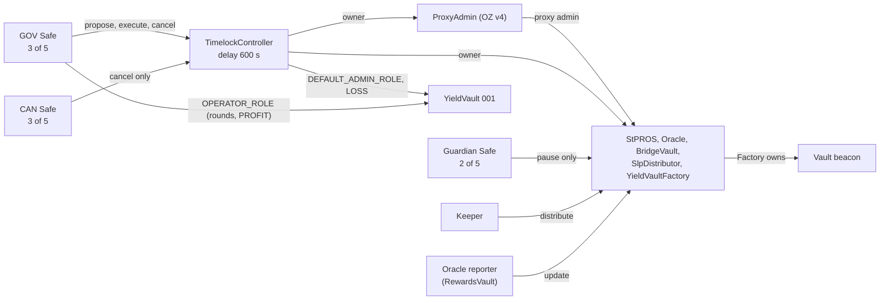

# Governance

## Purpose

This document explains who controls the Faroo contracts on Pharos Mainnet, what each role can and cannot do, and how
governance transactions are executed. The first part describes the **current state after the V4 upgrade of
2026-10-21**, read from chain at block 20,815,667. The second part keeps the release-governance design and procedures
that prepared and verified that upgrade. That part is a reference for future governed operations, not a user guide.

Governance is not trustless. The Timelock and the accounts behind it can upgrade every core contract, change
parameters and move BridgeVault custody. The delay and the separate canceller make changes visible before they apply;
they do not remove the trust.

## Current governance



### Roles

Addresses are authoritative in [`deployments/mainnet/v4/addresses.json`](../deployments/mainnet/v4/addresses.json).

| Role | Address | Permissions | Can be changed by | Restrictions |
|---|---|---|---|---|
| **GOV Safe** (3 of 5, Safe 1.4.1) | `0x3658e00f5ddb9fa0c7e9820e8d16c3c17eab73ca` | Timelock `PROPOSER_ROLE`, `EXECUTOR_ROLE`, `CANCELLER_ROLE`. YieldVault 001 `OPERATOR_ROLE` (the OPS role) | Timelock role changes: the Timelock itself. Vault role: the Timelock (`DEFAULT_ADMIN_ROLE`). Signers and threshold: the Safe itself | Every protocol change it proposes waits the Timelock delay. No direct ownership of core contracts |
| **CAN Safe** (3 of 5, Safe 1.5.0) | `0xb3c8a7f291e128e5d1ff3e2aa09fe8a9b38fce76` | Timelock `CANCELLER_ROLE` only | The Timelock itself | Cannot propose, execute, upgrade, pause or move assets |
| **Guardian Safe** (2 of 5, Safe 1.5.0) | `0xa046988889871c6c7abc69e63cccf9adb3e57ef5` | `pause()` on StPROS, Oracle, BridgeVault, SlpDistributor and YieldVaultFactory (`guardian()`) | Timelock: `setGuardian(address)` on each contract | Cannot unpause, upgrade, change parameters or move assets. No Timelock role |
| **TimelockController** (OZ 5.6.1) | `0xc30db0543412c6881a543390d2c21fbbff42805b` | Owner of the ProxyAdmin, StPROS, Oracle, BridgeVault, SlpDistributor and YieldVaultFactory. `DEFAULT_ADMIN_ROLE` of YieldVault 001. The only LOSS authority for vaults. Its own admin | Itself: role and delay changes are Timelock operations | Acts only through operations proposed by GOV and executed after the delay. No open executor role |
| **ProxyAdmin** (OZ v4) | `0x4238ea4adfa2bd6a5fc9b5e245dc1900cf0258aa` | Admin of the five core proxies: `upgrade`, `upgradeAndCall` | Owner: the Timelock | Every call comes from the Timelock |
| **YieldVaultFactory owner** | The Timelock | Create vaults, whitelist counterparties, set the approved performance fee, upgrade the vault beacon, emergency-cancel or retire vaults, close creation | — | Through the Timelock only |
| **YieldVault OPERATOR_ROLE** (OPS) | GOV Safe | `openNextRound`, `extendOpenPeriod`, PROFIT `proposeSettlement`, cancel a non-LOSS proposal | Timelock (`DEFAULT_ADMIN_ROLE` of the vault) | Cannot propose or replace a LOSS. Acts directly, without the Timelock delay |
| **Keeper** | `0x8736e68f37c1156e09445ac2d395a139e58fcab4` | `SlpDistributor.distribute` to whitelisted destinations. Also `WHITELIST_ROLE` on the SLP contracts and the RewardsVault | SlpDistributor: Timelock (`setKeeper`). SLP roles: the SLP administrator | Cannot change the whitelist. See [SLP-STAKING.md](SLP-STAKING.md#keeper-responsibilities) |
| **Oracle reporter** | `0xd0c44d3079e97ff285dd7a3e4e0246320a9487e5` (SlpPharosRewardsVault) | `Oracle.update`: add bounded yield | Timelock: `Oracle.setSlp(address)` | Bounded by the interval, APR allowance and absolute cap ([PARAMETERS.md](PARAMETERS.md#oracle-and-yield-reporting)) |
| **Treasury** | `0x3754fd5ec997c07ca528bb0bdcb0b4f5b93605df` | Receives commission shares. Counterparty and fee recipient of YieldVault 001 | Commission recipient: Timelock (`setCommissionConfig`). Vault counterparty: fixed at vault creation | No protocol permissions. An account without contract code at block 20,815,667 |
| **SLP administrator** | `0x976cf43c894ba43cf096da8c1427f6a51b724bb9` | `DEFAULT_ADMIN_ROLE` of both SLP execution contracts and the RewardsVault; owner of their ProxyAdmin `0x480eb384681777bf21e72b8c8538987c2801b4b7` | Itself | **Outside the Timelock.** A single account without contract code (block 20,817,024). See [SLP-STAKING.md](SLP-STAKING.md#changeable-by-governance-or-by-the-slp-administrator) |

### Who can do what

| Action | Who | How |
|---|---|---|
| Upgrade StPROS, Oracle, BridgeVault, SlpDistributor or YieldVaultFactory | Timelock | `ProxyAdmin.upgrade` / `upgradeAndCall`, proposed by GOV, executed by GOV after the delay |
| Upgrade the YieldVault implementation | Timelock | `YieldVaultFactory.upgradeBeaconTo` |
| Change Oracle parameters, reporter, commission, or correct `T` | Timelock | `setMaxAprPpm`, `setUpdateLimits`, `setCommissionConfig`, `setSlp`, `setTokenAmount` |
| Change the waiting period or the record limit | Timelock | `StPROS.setUnbondingPeriod`, `setMaxWithdrawCount` (new requests only) |
| Change the SlpDistributor whitelist or keeper | Timelock | `setSlps`, `setKeeper` |
| Move BridgeVault custody | Timelock | `BridgeVault.emergencyWithdraw` |
| Pause a core contract | Guardian Safe, or the Timelock as owner | `pause()` |
| Unpause | Timelock only | `unpause()` |
| Replace the guardian | Timelock | `setGuardian` per contract |
| Open or extend vault rounds; propose or cancel PROFIT | OPS (GOV Safe), directly | YieldVault functions |
| Propose, replace or cancel a LOSS | Timelock | YieldVault `proposeSettlement(LOSS, …)` from the Timelock |
| Fund a PROFIT proposal, finalize a settlement, force a par settlement after the deadline | Anyone | `fundProfit`, `finalize`, `forceParSettlement` |
| Propose and execute Timelock operations | GOV Safe | `schedule` / `scheduleBatch`, then `execute` / `executeBatch` |
| Cancel a pending Timelock operation | GOV Safe or CAN Safe | `cancel(id)` |
| Change SLP pool lists, operators, return addresses, implementations | SLP administrator | SLP contract roles and their ProxyAdmin. **Not part of the Timelock system** |

### Two-stage Safe and Timelock execution

Every **Timelock-executed governance operation** takes two GOV Safe transactions. This covers every action whose caller
must be the owner of a core contract, the ProxyAdmin or the Factory, and every Timelock-only vault action (LOSS):
upgrades, parameter and address setters, `unpause`, guardian replacement, custody recovery and Timelock role or delay
changes.

1. **Schedule.** GOV signers (3 of 5) execute a Safe transaction that calls `scheduleBatch(targets, values, payloads,
   predecessor, salt, delay)` on the Timelock. The operation ID is the hash of all those fields. `CallScheduled` events
   publish the exact calls.
2. **Wait.** The operation can be executed only after `delay ≥ getMinDelay()` seconds. During that time the GOV Safe or
   the CAN Safe can cancel it.
3. **Execute.** GOV signers execute a second Safe transaction calling `executeBatch` with identical fields. The batch is
   atomic: if one call fails, nothing applies.

Anyone can watch `CallScheduled`, `CallExecuted` and `Cancelled` on the Timelock to see changes before they apply.

### Actions executed directly, without the Timelock

These permissions act immediately, in a single transaction by their holder. They do not pass through the Timelock and
do not appear in its events.

| Action | Holder | Limits |
|---|---|---|
| `pause()` on a core contract | Guardian Safe (also the owner, through the Timelock) | Stops the paused contract's guarded functions; cannot unpause, change parameters or move assets |
| Vault round operations: `openNextRound`, `extendOpenPeriod`, PROFIT `proposeSettlement`, cancelling a non-LOSS proposal | OPS (`OPERATOR_ROLE`, currently the GOV Safe through its own Safe transactions) | Within the vault's constants and the Factory-approved fee; no LOSS authority |
| `SlpDistributor.distribute` | Keeper | Only to whitelisted destinations, from the distributor's balance, while unpaused |
| `Oracle.update` (through `notifyOracle`) | Oracle reporter and its operators | Bounded by the interval, APR allowance and absolute cap |
| SLP pool, operator and return-address management | SLP administrator and `WHITELIST_ROLE` holders | Outside the Timelock system ([SLP-STAKING.md](SLP-STAKING.md)) |
| Deposits, redemption requests, claims, vault deposits and redemptions, `fundProfit`, `finalize`, `forceParSettlement`, `unwrapWrapped` | Any user, under each function's own conditions | No governance authority |

### Timelock delay

The current delay is **600 seconds**, chosen by the owner for the V4 configuration phase. During this phase every
governance operation, including an upgrade, needs only 600 seconds of notice. This is a disclosed governance risk.

The owner's policy is to raise the delay to **86,400 seconds (24 hours)** once configuration is complete. That needs a
separate owner authorization and a Timelock operation calling `updateDelay(86400)` on the Timelock itself. Nothing
switches automatically. At block 20,815,667, `getMinDelay()` returned 600.

### Signer overlap

Safe `getOwners()` at block 20,815,667:
- the CAN Safe and the Guardian Safe have the same five owners;
- the GOV Safe shares two owners with them;
- one of those shared owners, `0x976c…4bb9`, is also the SLP administrator.

The roles are separated at contract level, but they are not held by fully independent signer groups.

### Out-of-scope legacy contracts

The historical test factory `0xbc3a9090bbf303d7c49ff8f3a7e9f48679b42d00` and its vault
`0xc775dfaa7565f2aca5ddf5dd6837ceb846de591b` were left out of V4 by owner decision:
- they still run their V1 code and are owned by an externally owned account;
- the test vault is LOCKED (block 20,816,199).

They are not production contracts and are not governed by the Timelock. Their proxy admin is the shared ProxyAdmin,
which the Timelock now owns.

### History

| Period | Owner of the core contracts |
|---|---|
| V1 (until block 20,812,661) | GOV Safe directly; no Timelock |
| V4 handoff, block 20,812,661 (`0x8649402f…097add`) | Ownership of the ProxyAdmin, StPROS, Oracle and YieldVaultFactory moved to the Timelock; U scheduled |
| V4 upgrade, block 20,813,316 (`0xac1fd830…f31e1b`) | Implementations upgraded and configured by the Timelock; `assertR4` passed in the same batch |

The pre-upgrade snapshot at block 19,774,476 is in [DEPLOYED-STATE.md](DEPLOYED-STATE.md) (historical, generated).

---

## Release governance design (reference)

The rest of this document is the approved release-governance design used to prepare, verify and execute the V4
upgrade. It is kept unchanged as the reference for future governed releases and LOSS contingencies. Statements about
planned values are marked where mainnet V4 superseded them; current values are in [PARAMETERS.md](PARAMETERS.md).

The research repository's frozen audit roadmap and R1-final + A1 amendments are authoritative. This development tooling does not authorize deployment. Development occurs on `main`; all changes remain uncommitted until requested.

| Authority | Approved responsibility |
|---|---|
| GOV | Sole Timelock proposer and executor, also canceller. Mainnet: `0x3658e00f5DDb9Fa0c7e9820e8d16C3C17eaB73CA` |
| CAN | Timelock canceller only; never proposer/executor, ProxyAdmin or vault authority; never GOV. Mainnet: `0xB3c8A7F291E128e5D1fF3E2aA09fe8A9B38FCe76` |
| GRD | The configured `guardian()` of the guarded contracts: emergency pause within its authorized scope only; cannot unpause, upgrade, propose, execute, operate vaults or move assets; no Timelock role unless it is also CAN. Mainnet: `0xa046988889871c6c7aBc69e63ccCf9AdB3E57ef5` (separate from CAN; CAN = GRD is also allowed) |
| OPS | Governed YieldVault OPERATOR_ROLE: round operations and PROFIT settlement, never LOSS (Timelock only). Mainnet: the GOV address (GOV != OPS is also allowed). Never CAN, GRD, the Timelock or counterparty/fee recipient |
| Timelock | Owns shared recorded OZ v4 ProxyAdmin and all core/Factory proxies; LOSS authority |
| Factory | Owns its existing beacon; only Timelock can upgrade it |
| Treasury | Reviewed Safe receiving mainnet future-yield commission |
| Deployer | No retained Timelock role or Safe signer authority after setup |

Mainnet delay is 600 seconds through H -> U and the configuration phase; the later 86,400 seconds is a separately authorized Timelock self-call (`docs/SPEC.md`). Testnet is exactly 300 seconds. Timelock is its own sole default admin, GOV has proposer/executor/canceller, CAN has canceller, and there is no open executor. Mainnet governance (owner, 2026-10-20): addresses in `tools/release/mainnet-governance.json` (deployer `0x8Ce84E9Fa0101D317D8956D73610ad3e0E219d41`), changeable by the owner. GOV = OPS and CAN = GRD are each allowed but not required; GOV != CAN, GRD != GOV, OPS is neither CAN nor GRD, and no role is the Timelock. DEFAULT_ADMIN_ROLE of the governed vault stays with the Timelock, and LOSS runs only through the Timelock. The release tooling checks roles and permissions only (hasRole, owner, guardian, static calls). Safe internals (code, singleton, owners, threshold, modules, guard, nonce, signer sets, signer evidence) are the owner's own management and are not checked for V4 configs; the frozen R4 corpus configs keep the recorded R4 Safe checks for conformance replay only. (Frozen R4 replay only: the R4 engine required Safe identities, singleton hashes, owners, thresholds, nonce, empty module lists, zero guard and EOA signer control, `INCOMPLETE_SAFE_SIGNER_CONTROL`.) Simulations may use labelled synthetic actors.

`ReleaseAssertions` has no storage, privileged function, delegatecall, external state-changing call or administrator. Every function is view/pure. It checks reviewed expectations by STATICCALL. Proxy admin/implementation checks go through the **recorded OZ v4 ProxyAdmin** public `getProxyAdmin`/`getProxyImplementation` wrappers. It never pretends its own SLOAD can inspect another contract. Initializer versions are checked with pinned RPC storage reads at the OZ namespaced initializer slot.

A role-array hash binds calldata; it does **not** establish inventory completeness. The off-chain gate rescans every RoleGranted/RoleRevoked event for all role IDs, from a block before code existed, in contiguous windows of at most 1,000 blocks; unexpected RoleAdminChanged requires review. It compares the replay to actual `hasRole` state. Before execution and after migration, every live role outside owner-approved residual retirement targets must exactly match the frozen expected set, including formerly unknown actors. C/D and E2-unavailable vault roles remain completely inventoried but informational: they are explicitly accepted exposure before U and inert only after verified retirement. An RPC provider capable of omitting historical data remains a trust assumption; independently reviewed complete history and release rehearsal are mandatory.

The product policy is unchanged: mainnet launch commission 100,000 ppm on future yield, Treasury Safe recipient; approved APR is twice owner-selected expected gross APR and at most 500,000 ppm; update interval at least one hour. *(Superseded on mainnet: the V4 values are 3 × a 10 % expected APR, i.e. 300,000 ppm, and a 72,000-second interval; see [PARAMETERS.md](PARAMETERS.md).)* Factory launch performance fee is zero, future changes are Timelock-only and capped at 3,000 bps. Historical round fees and their 10,000 denominator remain unchanged. New unbonding settings have a one-day floor and thirty-day ceiling; migrations preserve the historical mainnet seven-day and testnet zero settings and individual withdrawal records. *(Mainnet V4 then set 86,400 seconds for new requests in the upgrade transaction; records created earlier keep seven days.)*

Reporting allowance (operational note, unchanged economics): each `update` may add at
most `T × maxAprPpm × min(elapsed, 7 days) / (365 days × 10^6)`, also bounded by the
absolute per-update cap, and `elapsed` restarts at every successful update. Unused
elapsed-time allowance beyond seven days is therefore not banked. This does not by
itself prove that earlier accrued yield can never be reported: reports carry no accrual
period, so later permitted updates may include backlog within their own allowance and
cap, and the allowance may already exceed actual accrued yield.

Hardhat Tasks (including legacy direct Oracle/StPROS upgrades, beacon upgrades, ownership handoff, deprecated initializer/setter Tasks and `yield-vault:loss-calldata`), the `deploy` override and the deploy stubs were removed from Production with the framework. The native CLI exposes only the `release`, `artifact` and `loss contingency` routes and refuses deploy/sign/send or key arguments before reading any input. Release builders never produce `changeProxyAdmin`, `renounceOwnership`, an implementation-only core upgrade, or an unguarded initializer. Ordinary administrative calls are not a release workflow; only reviewed Timelock calldata is authorized for an R4 release.

The RPC checks distinguish the approved historical block from the current chain head. They independently bind every selected historical target (including Oracle and testnet BridgeVault/SlpDistributor) to the chain-specific registry; mainnet fresh BridgeVault/SlpDistributor require separate reviewed deployment records. Standalone release builders enforce that registry binding too. Current proxy/Beacon code and upgrade/admin history are checked in addition to getters. No atomic assertion was moved off-chain during review closure; the Solidity refactor preserves its public ABI and only consolidates repeated Vault asset reads.

### Approved governance closure (2026-10-10)

The conversation-approved GC-01 A / GC-02 C / GC-03 B amendment narrows mainnet
governed-Vault handoff to effective SETTLED throughout reviewed input, fresh
pre-schedule, H, execution checkpoint and final U. Residual/testnet rules and
Vault economics remain unchanged. Timelock coverage is explicitly all
**action-bearing** operations (one or more target calls) plus referenced
predecessor states; global event-silent empty-ID discovery is not claimed.
Pending includes Waiting/Ready actions even with blocked predecessors. Pre set
empty, H exactly frozen U with zero predecessor, post set empty and U Done.
The source proof, complete authenticated archive/journal and pinned OZ runtime
are prerequisites; a parser alone does not prove whole-operation completeness.

### LOSS contingency planning (LAB-F-01, approved 2026-10-10)

A Guardian pause can make a scheduled LOSS miss the fixed proposal cutoff and
indirectly change who bears the round outcome. GRD cannot directly transfer custody
or change NAV. This is an operational mitigation with residual timing/economic
risk, not a contract-level fix. The effect can reach the approved round loss cap
(50% maximum); it is not bounded solely by a short outage duration.

For one reviewed LOSS amount and round, prepare and independently schedule both:

| Path | Exact ordered target calls | Required execution state |
|---|---|---|
| A | Vault `proposeSettlement(LOSS, approvedAmount, address(0))` | Factory unpaused |
| B | Factory `setGuardian(reviewedReplacementGuardian)`; Factory `unpause()`; same Vault LOSS call | Factory paused; one atomic Timelock batch |

B rolls back in full if any call fails, including `unpause()` when already
unpaused. A fails while paused. Neither path works in both pause states. Replacing
GRD is effective only when B succeeds; approve the exact replacement independently.
No tooling may invent a Guardian, Safe, signer approval, amount or new round terms.

Timing (owner-approved clarification, 2026-10-13): LOSS operations may be scheduled
before maturity. The Timelock delay runs from scheduling, the Vault proposal still
requires maturity and the cutoff, and finalization keeps the settlement window, so a
LOSS round settles no earlier than
`max(scheduleTime + minDelay, maturity) + settleTimelockWindow`. An operation that is
Ready before maturity is refused (`VaultNotMatured`) until maturity and is not consumed
by that failure; CAN or GOV may cancel it at any time before execution
(`tests/security/LossSettlementTiming.t.sol`). Scheduling earlier lengthens the period
in which unused operation IDs must be tracked and cancelled.

Compute `D = openDeadline + lockDuration + SETTLEMENT_GRACE` and
`proposalCutoff = D - settleTimelockWindow`. Schedule **both** operations no later
than `proposalCutoff - actualMinDelay - reviewedMargin`. The margin is a positive,
explicitly reviewed operational input, not a release constant. Ensure maturity
also leaves the margin before cutoff. Exact cutoff is accepted by the contract;
operators must retain the reviewed margin rather than plan for last-second
inclusion. If neither reviewed path can safely execute before cutoff, report
**BLOCKED** and independently re-review; never extend D or silently change amount,
Guardian, calldata, salts or operation IDs. OPS pre-emption, new pauses, unavailable
signers, transaction inclusion and other state changes remain risks.

`python3 -m tools.release.native loss contingency` is the only LOSS preparation
route; it is unsigned and read-only (usage below). The former single-call
`yield-vault:loss-calldata` Task was retired with the Hardhat framework under the
owner's minimal native toolchain decision and has no replacement command. Path A's
single call is byte-identical standalone `proposeSettlement(LOSS, amount, address(0))`
calldata. The command checks current chain, approved runtimes, Factory proxy admin/implementation,
Vault beacon/implementation/asset, Factory registry membership and Vault back-link,
owners, authority getters, round terms, delay, backing and selected operation IDs.
Release mode binds historical canonical Factory/asset/Beacon/ProxyAdmin identities
to the existing chain registry and the Timelock to the GC-03 pinned OZ runtime.
Full runtime hashes (including Factory immutable binding) must be independently
approved from known source/artifacts, never copied from unchecked observations.
The pure builder is not a chain attestation; release-oriented output must use the
observing command. Fresh read-only state is evidence at a pinned block, not a promise
that it remains unchanged through scheduling or execution.

The command supports new paired plans for effective LOCKED, non-retired rounds
only; it refuses existing proposals and selected IDs already scheduled or Done, so it
is a preparation check, **not** an execution-time checkpoint for operations that are
already scheduled. It checks only the named role/operation subset, does not enumerate
all role holders or Timelock operations, does not authenticate Safes, and does not
schedule, execute or cancel. A reviewed plan is valid for at most 3,600 seconds after
`reviewedAt`; observations must be fresh as stated below. Execution timing is
`max(ready, maturity)` with `ready = max(now, observed block time) + minDelay`; plans
may therefore be prepared before maturity.
Existing proposal replacement, new unregistered Factory deployments, and arbitrary
proxy topologies need separate review. All artifacts remain `deployable: false`:
actual Safe identities, signer/control independence, nonces and execution approvals
are external requirements. Synthetic local identities are simulation-only.

After the selected path executes, **CAN may cancel the unused pending operation;
GOV retains its approved canceller capability**. Verify the selected ID is Done,
the unused ID is Unset after cancellation, and the full final operation inventory
matches the actual execution and cancellation receipts. The unused operation may
still replace a proposal or act on a later round: LOSS calldata has no round-index
argument. A currently reverting Ready call is not closed. Waiting and Ready both
remain pending, including blocked dependencies. Keep the original immutable bundle;
a changed payload means a new operation requiring new review and the full delay.
Reconcile and cancel every unused LOSS operation ID before the Vault opens its next
round; an uncancelled ID remains executable by GOV against the later round's managed
assets (`tests/security/StaleLossOperation.t.sol`). GC-03 action-bearing history and
reconciliation remain authoritative. This command's two-ID check neither enumerates all operations nor satisfies GC-03 by itself. Paired
LOSS operations do not bypass the existing H/U release inventory constraints.

Monitor each intended/scheduled LOSS for cutoff, latest scheduling time, actual
delay, Waiting/Ready/Done/cancelled status, Factory pause and Guardian identity.
Escalate before the paired scheduling window closes, immediately on a pause near
cutoff, on a missed cancellation, or on round/amount/role/owner/code/asset drift.
Unexpected history, a changed Safe/Guardian approval, insufficient backing, revoked
authority, a stale/reorged observation or failure of either execution simulation
requires independent re-review. Recheck runtime conditions immediately before
execution, including finalization's separate pause/window dependency. A Ready
operation alone is insufficient. No command or runbook here authorizes a mainnet
or testnet transaction.

#### LOSS plan input and read-only usage

Run only in the allowlisted export through `tools/verify/run.sh`:

```bash
tools/verify/run.sh "$dest" python3 -m tools.release.native loss contingency --plan /absolute/path/to/reviewed-loss-plan.json --review-hash "$REVIEWED_PLAN_SHA256" --rpc "$PUBLIC_READ_ONLY_RPC"
```

The operator must independently supply `REVIEWED_PLAN_SHA256` and
`PUBLIC_READ_ONLY_RPC`. This example does not authorize execution of any
governance transaction.

No wallet client, signature or transaction is acquired. Missing proof inputs are
blocked; the owner approval for developing this tool is not a release plan approval.
The JSON schema is `faroo-loss-contingency-v1`:

| Input fields | Reviewed meaning |
|---|---|
| `mode`, `chainId` | `simulation` or `release`; integer chain ID (release: 1672/688689) |
| `vault`, `factory`, `timelock`, `asset`, `beacon`, `factoryImplementation`, `vaultImplementation`, `proxyAdmin` | Exact lowercase nonzero approved contract identities |
| `guardian`, `replacementGuardian`, `gov`, `can`, `operator`, `counterparty`, `feeRecipient` | Exact reviewed actors; replacement differs from current GRD and excluded authorities/recipients. A mainnet plan under `timelockDelayPolicy: V4-CONFIG-600` requires `operator = gov` and `guardian = can` |
| `runtimeHashes` | Map keyed by the eight contract identity names above, full runtime Keccak-256 for each |
| `round` | Exact decimal-string `roundIndex`, `openedAt`, `openWindow`, `openDeadline`, `lockDuration`, `settleTimelockWindow`, `roundCap`, `perAddressCap`, `minSubscription`, `performanceFeeBps`, `maxLossBps` |
| `approvedLossAmount`, `minDelay` | Nonnegative decimal strings in raw asset units / seconds; observed delay must match |
| `reviewedAt`, `expiresAt`, `reviewReference` | Independently approved Unix-second strings and evidence reference; review expires within one hour |
| `marginSeconds`, `marginReviewReference` | Positive decimal seconds and independent operational-margin decision |
| `predecessor`, `saltA`, `saltB` | Zero bytes32 predecessor; distinct reviewed bytes32 salts |
| optional `frozenOperationIds` | Exact `{ "A": "0x…", "B": "0x…" }`; any reconstructed ID mismatch blocks, never rewrites |

Fresh heads are at most 120 seconds old with at most 30 seconds future clock skew;
scans must finish within a 120-second head advance and recheck the canonical hash.
Those are observation freshness limits, not the independently chosen scheduling
margin. Fresh observations never renew an expired plan or existing operation.
