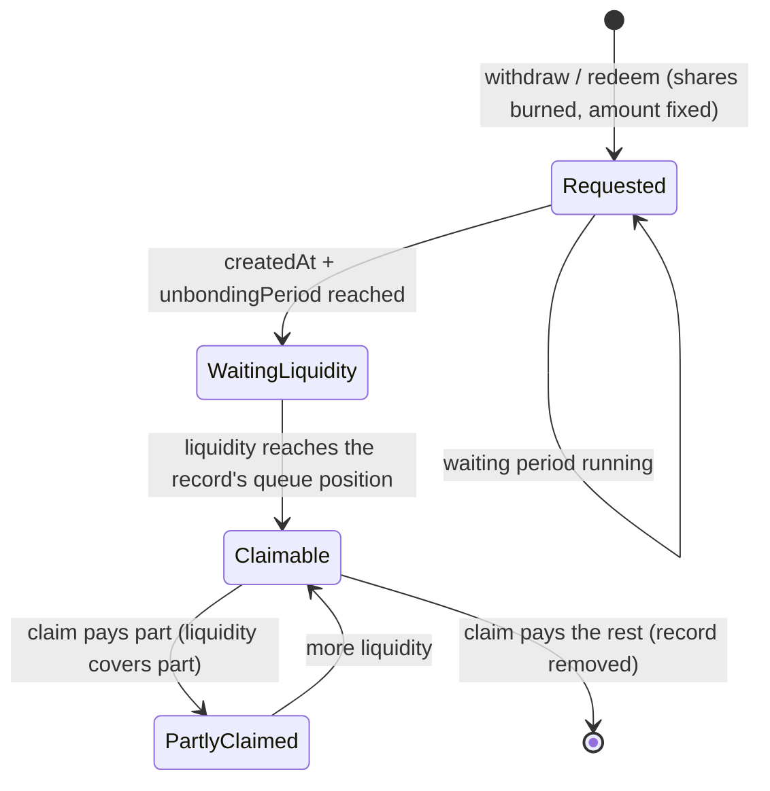

# Integration guide

## Purpose

This guide is for wallets, DeFi protocols, aggregators and front-end or back-end engineers who integrate stPROS on
Pharos Mainnet. It covers deposits, redemption requests, claims, the queries a UI needs and the events an indexer
should follow.

**The most important rule:** in stPROS, ERC-4626 `withdraw` and `redeem` **create a redemption request**. They burn
shares and return immediately, but no PROS or WPROS is transferred in that transaction. The assets are claimed later
with `withdrawComplete` / `withdrawCompleteToPROS`, after the request's waiting period **and** once redemption
liquidity reaches it.

## Network and contracts

| Item | Value |
|---|---|
| Network | Pharos Mainnet, chainId `1672` |
| Public RPC (used here for reads only; rate-limited) | `https://rpc.pharos.xyz`. It rejects `eth_getLogs` ranges above 1,000 blocks |
| Block explorer | Not recorded in this repository. Check addresses against [`addresses.json`](../deployments/mainnet/v4/addresses.json) |
| stPROS | `0x6b0a44c64190279f7034b77c13a566e914fe5ec4` (proxy), 18 decimals, symbol `stPROS` |
| WPROS (asset) | `0x52c48d4213107b20bc583832b0d951fb9ca8f0b0`, 18 decimals |
| Oracle, BridgeVault, others | [README](../README.md#mainnet-deployment), [`deployments/registry.json`](../deployments/registry.json) |

**ABIs.** Use the `abi` array of the V4 records:

| Contract | ABI file |
|---|---|
| StPROS | [`deployments/mainnet/v4/StPROS.json`](../deployments/mainnet/v4/StPROS.json) |
| Oracle | [`deployments/mainnet/v4/Oracle.json`](../deployments/mainnet/v4/Oracle.json) |
| BridgeVault | [`deployments/mainnet/v4/BridgeVault.json`](../deployments/mainnet/v4/BridgeVault.json) |
| YieldVaultFactory, YieldVault | [`v4/YieldVaultFactory.json`](../deployments/mainnet/v4/YieldVaultFactory.json), [`v4/YieldVault.json`](../deployments/mainnet/v4/YieldVault.json) |

Do not use the files directly under `deployments/mainnet/` (for example `deployments/mainnet/StPROS.json`): they hold
the **pre-upgrade V1 ABI**. Call proxy addresses, never implementation addresses. A program can read the
`networks.mainnet.contracts[].abi.file` entries of `deployments/registry.json`.

## Deposits

All deposits mint stPROS at the current Oracle rate. The PROS is forwarded to the SlpDistributor in the same
transaction.

| Function | Input | Shares go to | Returns |
|---|---|---|---|
| `deposit(uint256 assets, address receiver)` | WPROS (requires `approve(stPROS, assets)` on WPROS) | `receiver` | shares minted |
| `mint(uint256 shares, address receiver)` | WPROS; pulls `previewMint(shares)` | `receiver` | assets pulled |
| `depositWithPROS()` payable | native PROS as `msg.value` | `msg.sender` only | shares minted |

**Quotes and conversions.**

| View | Meaning |
|---|---|
| `previewDeposit(assets)` | Shares for `assets`, rounded down. Also used by `depositWithPROS` |
| `previewMint(shares)` | WPROS needed for `shares`, rounded up |
| `convertToAssets(shares)`, `convertToShares(assets)` | Rate conversions, rounded down |
| `totalAssets()` | PROS value of the whole supply, from the Oracle |
| `balanceOf(account)` | stPROS shares held |
| `Oracle.poolInfo(WPROS)` | `(tokenAmount T, vTokenAmount V)`; rate = `T / V` |

**Notes.**
- **No minimum-output parameter.** The rate changes only when the Oracle accepts a yield report or governance applies a
  correction; it rises with yield. If you need a hard bound, call from a contract that checks the returned shares (see
  [the Solidity example](#solidity)).
- **`maxDeposit` / `maxMint`** return the ERC-4626 default (`type(uint256).max`). They do not report pauses.
- **Reverts.** A deposit reverts when StPROS or the Oracle is paused (`EnforcedPause()`), when `msg.value` is zero
  (`PROSNotSent()`), or when an allowance or balance is missing.
- **No direct transfers.** Do not send PROS or WPROS directly to the stPROS contract; it mints nothing for them.
  Native PROS is accepted only from the WPROS contract, and forced native transfers cannot be recovered.

## Redemptions

### Lifecycle



1. **Request.** `redeem(shares, receiver, owner)` or `withdraw(assets, receiver, owner)`:
   - burns the owner's shares;
   - fixes the PROS amount at the current rate: `previewRedeem(shares)` rounds down, `previewWithdraw(assets)` burns
     shares rounded up;
   - appends a record to the **owner's** queue and emits `Withdraw`.
2. **Wait.** The record becomes mature at `createdAt + unbondingPeriod`. `unbondingPeriod` is copied into the record at
   request time; a later governance change does not affect existing records. Current value:
   [PARAMETERS.md](PARAMETERS.md#redemption-queue).
3. **Liquidity.** A mature record is payable only when
   `getTotalBalance() = BridgeVault liquidity + completedWithdrawal` exceeds the record's `queued` baseline. The
   baseline is the total of all requests made before it, across all users: the queue is first-in, first-out globally.
4. **Claim.** The owner calls one of the claim functions. They walk the owner's records in order, pay what is payable
   and stop at the first record that is not mature or not funded. A record can be paid in part; the remainder stays
   queued.

**Do not assume a claim date.** The waiting period is a minimum. If the BridgeVault does not yet hold liquidity up to a
record's queue position, the claim pays nothing for that record (it returns 0 and does not revert), even after the
waiting period. Liquidity depends on operations, including Pharos unbonding ([SLP-STAKING.md](SLP-STAKING.md)).

### Request functions

| Function | Burns | Queues | Returns |
|---|---|---|---|
| `redeem(uint256 shares, address receiver, address owner)` | `shares` | `previewRedeem(shares)` PROS | assets queued |
| `withdraw(uint256 assets, address receiver, address owner)` | `previewWithdraw(assets)` | `assets` PROS | shares burned |

- `owner` holds the record and is the only account that can claim it (claims use `msg.sender`'s queue). If the caller
  is not `owner`, the caller needs a stPROS allowance from `owner`.
- If `receiver == owner`, the record has no fixed receiver. The claim pays `msg.sender`, or the receiver passed to
  `withdrawComplete(receiver, …)`. If `receiver != owner`, the record is bound to `receiver` for good.
- Each owner can have at most `maxWithdrawCount` outstanding records. Another request reverts with
  `ExceedMaxWithdrawCount(uint256)`. `maxWithdraw` / `maxRedeem` do not reflect this limit or pauses.
- Requests revert while StPROS or the Oracle is paused.

### Claim functions

| Function | Pays | Unbound records pay | Bound records pay |
|---|---|---|---|
| `withdrawComplete()` | WPROS | `msg.sender` | their receiver |
| `withdrawComplete(uint256 maxRecords)` | WPROS | `msg.sender` | their receiver |
| `withdrawComplete(address receiver)` | WPROS | `receiver` | their receiver |
| `withdrawComplete(address receiver, uint256 maxRecords)` | WPROS | `receiver` | their receiver |
| `withdrawCompleteToPROS()` | native PROS | `msg.sender` | their receiver |
| `withdrawCompleteToPROS(uint256 maxRecords)` | native PROS | `msg.sender` | their receiver |

- Every claim function returns the total amount paid, which can be 0.
- `maxRecords` bounds the number of records fully consumed in one call (0 means no limit). Use it to bound gas.
- Native payouts fall back to WPROS if the receiver rejects native PROS.
- Claims work while StPROS or the Oracle is paused. A claim that would pay something reverts while the BridgeVault is
  paused.
- These functions are overloaded. In ethers v6 call them by full signature, for example
  `stpros["withdrawCompleteToPROS()"]()`.

### Queue queries

| View | Returns |
|---|---|
| `getWithdrawals(owner)` | Outstanding records in order: `(queued, pending, createdAt, unbondingPeriod, receiver)[]`. `receiver` is zero for unbound records |
| `canWithdrawalAmount(owner)` / `canWithdrawalAmount(owner, maxRecords)` | `(claimableNow, fullyClaimableRecords, partialAmount)`. Same walk as a claim, without paying |
| `withdrawalHead(owner)`, `withdrawalTail(owner)` | Index range of outstanding records: head inclusive, tail exclusive |
| `getTotalBalance()` | `BridgeVault.getBalance(WPROS) + completedWithdrawal`, the liquidity frontier |
| `queuedWithdrawal()`, `completedWithdrawal()` | Cumulative requested and cumulative paid amounts; the outstanding total is the difference |
| `unbondingPeriod()`, `maxWithdrawCount()` | Settings applied to **new** requests |

**Requested total vs. claimable now.** Outstanding = the sum of `pending` over `getWithdrawals(owner)`. Claimable now =
`canWithdrawalAmount(owner).claimableNow`. Both are previews: an intervening claim, a pause or a governance custody
action can change the result before a transaction executes.

**Liquidity still needed for a record:** `max(0, queued + pending − getTotalBalance())`.

## Developer examples

The examples use [ethers v6](https://docs.ethers.org/v6/) and human-readable ABI fragments taken from the V4 ABI. They
are illustrations, not a published SDK. They keep reads and transactions apart:

- **Reads** go through a read-only provider. The public RPC is used here only for `eth_call` and block reads.
- **Transactions** are signed and sent by a signer that the user or the calling service controls. In a front end this is
  the user's connected wallet, which broadcasts through its own connection. In a back end the caller passes in a signer
  from its own key management (for example a KMS, HSM or custody service). The examples never load or handle a private
  key.

```ts
import { BrowserProvider, Contract, JsonRpcProvider, Signer, parseEther, formatEther } from "ethers";

const STPROS = "0x6b0a44c64190279f7034b77c13a566e914fe5ec4"; // deployments/mainnet/v4/addresses.json
const WPROS = "0x52c48d4213107b20bc583832b0d951fb9ca8f0b0";

const stprosAbi = [
  "function deposit(uint256 assets, address receiver) returns (uint256)",
  "function depositWithPROS() payable returns (uint256)",
  "function redeem(uint256 shares, address receiver, address owner) returns (uint256)",
  "function previewDeposit(uint256 assets) view returns (uint256)",
  "function previewRedeem(uint256 shares) view returns (uint256)",
  "function convertToAssets(uint256 shares) view returns (uint256)",
  "function balanceOf(address account) view returns (uint256)",
  "function unbondingPeriod() view returns (uint256)",
  "function getTotalBalance() view returns (uint256)",
  "function getWithdrawals(address target) view returns ((uint256 queued, uint256 pending, uint256 createdAt, uint256 unbondingPeriod, address receiver)[])",
  "function canWithdrawalAmount(address target) view returns (uint256, uint256, uint256)",
  "function withdrawComplete() returns (uint256)",
  "function withdrawCompleteToPROS() returns (uint256)",
];
const wprosAbi = ["function approve(address spender, uint256 value) returns (bool)"];

// Reads only. Never used to send a transaction.
const reader = new JsonRpcProvider("https://rpc.pharos.xyz", 1672);
const stprosRead = new Contract(STPROS, stprosAbi, reader);

// Front end: the user's connected wallet signs and broadcasts.
async function walletSigner(): Promise<Signer> {
  const wallet = new BrowserProvider((window as any).ethereum);
  if ((await wallet.getNetwork()).chainId !== 1672n) throw new Error("Switch the wallet to Pharos Mainnet, chainId 1672");
  return wallet.getSigner(); // asks the user to connect
}

// Back end: the caller injects a signer from its own key management, already connected to the
// transaction endpoint it trusts. This module never sees key material.
function stprosWith(signer: Signer): Contract {
  return new Contract(STPROS, stprosAbi, signer);
}

const signer: Signer = await walletSigner(); // or: the signer passed in by your service
const stpros = stprosWith(signer);           // write calls
const me = await signer.getAddress();
```

**1. WPROS deposit**

```ts
const assets = parseEther("10");
await (await new Contract(WPROS, wprosAbi, signer).approve(STPROS, assets)).wait();
const expected = await stprosRead.previewDeposit(assets);
await (await stpros.deposit(assets, me)).wait(); // fewer shares than expected if a yield report lands first
```

**2. Native PROS deposit**

```ts
await (await stpros.depositWithPROS({ value: parseEther("10") })).wait(); // shares minted to msg.sender
```

**3. Rate and balance**

```ts
const shares = await stprosRead.balanceOf(me);
const valueInPros = await stprosRead.convertToAssets(shares);
const prosPerShare = await stprosRead.convertToAssets(parseEther("1"));
console.log(formatEther(shares), "stPROS ≈", formatEther(valueInPros), "PROS; rate", formatEther(prosPerShare));
```

**4. Create a redemption request**

```ts
const toRedeem = parseEther("5");
const queuedAmount = await stprosRead.previewRedeem(toRedeem); // PROS fixed by this request
await (await stpros.redeem(toRedeem, me, me)).wait();      // burns shares; pays nothing now
```

**5. Query the queue**

```ts
const now = BigInt((await reader.getBlock("latest"))!.timestamp);
const frontier: bigint = await stprosRead.getTotalBalance();
for (const w of await stprosRead.getWithdrawals(me)) {
  const unlockAt = w.createdAt + w.unbondingPeriod;
  const state = now < unlockAt ? "waiting period"
    : frontier <= w.queued ? "waiting for liquidity"
    : frontier - w.queued >= w.pending ? "claimable" : "partly claimable";
  console.log(formatEther(w.pending), state, "unlocks at", unlockAt.toString());
}
const [claimableNow] = await stprosRead.canWithdrawalAmount(me);
```

The loop shows each record's own state. A claim also stops at the first record that is not payable, so a later record
is never paid before an earlier record of the same owner. `canWithdrawalAmount` applies that rule.

**6. Claim**

```ts
if (claimableNow > 0n) {
  await (await stpros["withdrawCompleteToPROS()"]()).wait(); // or stpros["withdrawComplete()"]() for WPROS
}
```

### Solidity

A minimal interface and a deposit with a minimum-shares check:

```solidity
// SPDX-License-Identifier: GPL-3.0
pragma solidity ^0.8.28;

interface IStPROS {
    struct Withdrawal { uint256 queued; uint256 pending; uint256 createdAt; uint256 unbondingPeriod; address receiver; }
    function deposit(uint256 assets, address receiver) external returns (uint256 shares);
    function depositWithPROS() external payable returns (uint256 shares);
    function redeem(uint256 shares, address receiver, address owner) external returns (uint256 assetsQueued);
    function previewRedeem(uint256 shares) external view returns (uint256);
    function convertToAssets(uint256 shares) external view returns (uint256);
    function getWithdrawals(address owner) external view returns (Withdrawal[] memory);
    function canWithdrawalAmount(address owner) external view returns (uint256 claimable, uint256 fullRecords, uint256 partialAmount);
    function withdrawComplete(address receiver) external returns (uint256 paid);
    function withdrawCompleteToPROS() external returns (uint256 paid);
}

/// Example only. Holds no funds between calls.
contract StPROSDepositor {
    IStPROS public constant STPROS = IStPROS(0x6b0A44c64190279f7034b77c13a566E914FE5Ec4);

    error TooFewShares(uint256 got, uint256 minimum);

    /// Native deposit with a slippage bound. depositWithPROS mints to msg.sender (this contract),
    /// so the shares are forwarded to the user.
    function depositNative(uint256 minShares) external payable returns (uint256 shares) {
        shares = STPROS.depositWithPROS{value: msg.value}();
        if (shares < minShares) revert TooFewShares(shares, minShares);
        require(IERC20Like(address(STPROS)).transfer(msg.sender, shares));
    }
}

interface IERC20Like { function transfer(address to, uint256 value) external returns (bool); }
```

A contract that **holds** stPROS and redeems it is the owner of the record and must call the claim itself. It must be
able to receive WPROS or native PROS. Native payouts send PROS with a plain `call`; if that fails, the payout is sent
as WPROS.

## Events and indexing

| Contract | Event | When | Notes |
|---|---|---|---|
| StPROS | `Deposit(sender, owner, assets, shares)` | `deposit`, `mint`, `depositWithPROS` | `owner` is the share receiver |
| StPROS | `Withdraw(sender, receiver, owner, assets, shares)` | Redemption **request** | No assets moved. After a transaction with one request, its record index is `withdrawalTail(owner) − 1` |
| StPROS | `WithdrawalCompleted(caller, receiver, tokenAmount)` | Each record paid, fully or in part | `caller` is the queue owner. One event per record touched |
| StPROS | `Transfer(from, to, value)` | Mint, burn, transfer | Commission mints come from `0x0` to the Treasury |
| StPROS | `CommissionMinted(caller, account, shares)` | Yield report with commission | `caller` is the Oracle |
| StPROS | `UnbondingPeriodChanged`, `MaxWithdrawCountChanged`, `SlpChanged`, `BridgeVaultChanged` | Governance | Apply to new requests only |
| Oracle | `TokenAmountUpdated(token, addedAmount, newTokenAmount)` | Accepted yield report | Rate change: refresh conversions |
| Oracle | `CommissionMinted(token, vToken, account, tokenAmount, vTokenAmount)` | Same report | PROS value and shares of the commission |
| Oracle | `PoolUpdated(token, tokenAmount, vTokenAmount, isMint)` | Every deposit and request | New `T`, `V` |
| Oracle | `SetTokenAmount(token, tokenAmount, vTokenAmount)` | Governance correction of `T` | Rate change, up or down |
| Oracle | `UpdateLimitsChanged`, `MaxAprPpmChanged`, `CommissionConfigChanged`, `SlpChanged` | Governance | Report limits, commission, reporter |
| BridgeVault | `TokenWithdrawn(token, to, amount)` | Each claim payout | `token` is WPROS for both native and wrapped payouts |
| SlpDistributor | `PROSReceived(from, amount)`, `Distributed(slp, amount)` | Deposit inflow, keeper allocation | Operational monitoring |
| All core contracts | `Paused(account)`, `Unpaused(account)` | Guardian or Timelock | See the pause effects above |

- BridgeVault declares `EthReceived` but the current implementation does not emit it. Track liquidity with
  `getBalance(WPROS)` or native balance reads.
- A UI should derive a request's state from `getWithdrawals` and `getTotalBalance` at the current block, not from
  events alone: liquidity changes without a StPROS event.
- Public RPCs limit `eth_getLogs` to 1,000-block ranges; page your log queries.

## Risks for integrators

- **Pricing.** The rate depends on yield reports from one reporter, within on-chain limits. Governance can correct
  `T` downwards (`Oracle.setTokenAmount`). Requests made before an announced correction keep their fixed amounts.
- **Commission.** Commission is minted on every amount the Oracle accepts as a report. Non-reward funds reported by
  mistake raise the rate and are charged commission too; this is guarded operationally, not by the contracts
  ([SLP-STAKING.md](SLP-STAKING.md#known-risk-principal-reported-as-yield)).
- **Yield timing.** Yield accrues off-chain and is credited only when reported. A deposit made just before a report
  shares in it; a redemption request made just before a report does not.
- **Liquidity.** Redemptions depend on operational funding of the BridgeVault. The contracts guarantee order, not
  timing.
- **Governance.** The Timelock can upgrade every core contract, change parameters and move BridgeVault custody
  (`emergencyWithdraw`). Delays and roles: [GOVERNANCE.md](GOVERNANCE.md).
- **ERC-4626 differences.** `withdraw` / `redeem` do not transfer assets. `max*` views do not reflect pauses or the
  per-owner record limit.
