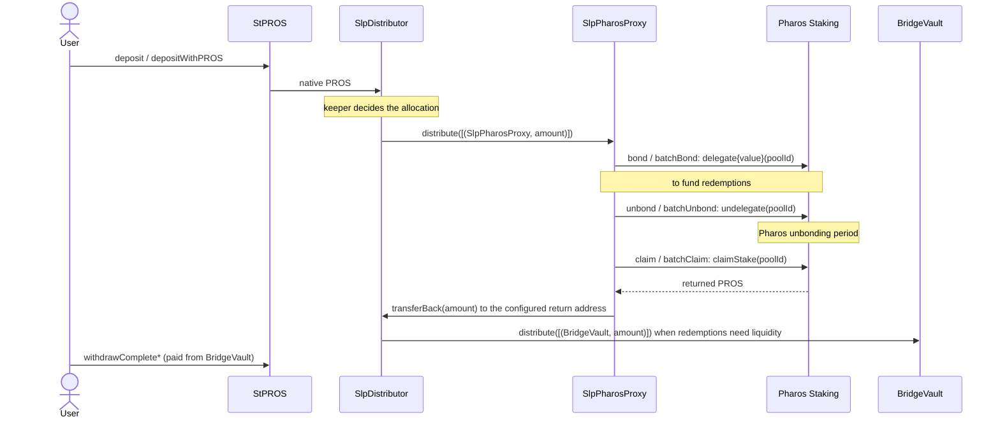
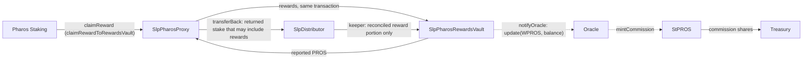

# SLP staking

## Purpose

This document describes how stPROS deposits reach Pharos staking, how staked PROS returns to fund redemptions, and how
staking rewards become stPROS yield. It also states which guarantees come from contracts and which depend on
operations.

SLP stands for staking liquidity provider: the layer that stakes the protocol's PROS on Pharos.

## Overview

| Component | Responsibility | Holds |
|---|---|---|
| **SlpDistributor** (`contracts/SlpDistributor.sol`) | Receives every deposit's PROS from StPROS. The keeper allocates it to whitelisted destinations. Also receives stake returned from Pharos | Unallocated PROS (principal and returned funds, not separated) |
| **SlpPharosProxy** (`contracts/SlpPharosProxy.sol`) | Delegates PROS to whitelisted Pharos validator pools, unbonds, claims returned stake and rewards, and sends returned stake back to its return address | PROS in transit; the delegations on Pharos |
| **Pharos Staking** (system contract `0x4100000000000000000000000000000000000000`) | Network staking: `delegate`, `undelegate`, `claimStake`, `claimReward`, `settleReward`, `compoundRewards` | Delegated stake and accrued rewards |
| **SlpPharosRewardsVault** (`contracts/SlpPharosRewardsVault.sol`) | Collects rewards and is the only account allowed to report yield to the Oracle (`notifyOracle`) | Rewards awaiting a report |
| **BridgeVault** (`contracts/BridgeVault.sol`) | Pays redemption claims | Redemption liquidity |

## Deployment status

Observed with read-only calls on Pharos Mainnet at **block 20,815,667**. Status can change; re-check the getters before
relying on it.

| Component | Source in this repository | Deployed on mainnet | Operating |
|---|---|---|---|
| SlpDistributor `0xf772…579f` | Yes; canonical V4 build; `a110037` core audit package | Yes, V4 record, verified | Receives deposits. Balance ≈ 974,849 PROS. The keeper had sent no transaction yet (nonce 0), so nothing had been allocated |
| SlpPharosProxy #1 `0xec1d…d612` | Yes; **not** in the canonical build or the `a110037` core audit package; not externally audited | Yes: proxy, implementation `0xc3d0…21ab`, administered outside the Timelock | **Not yet**: no registered pool, `totalBonded` 0, balance 0 |
| SlpPharosProxy #2 `0xc53d…0c2c` | Same as #1 | Yes: proxy, implementation `0xd15e…1124` (differs from #1), administered outside the Timelock | **Not yet**: no registered pool, `totalBonded` 0, balance 0 |
| SlpPharosRewardsVault `0xd0c4…87e5` | Yes; **not** in the canonical build or the `a110037` core audit package; not externally audited | Yes: proxy, implementation `0xe698…c531`, administered outside the Timelock | Configured as the Oracle reporter. Balance 0. No yield report since the upgrade |
| Pharos Staking `0x4100…0000` | Interface only (`IStaking`, not vendored) | Network system contract | Outside this repository |

Notes:
- The two SLP execution contracts are identified by their `SlpPharosProxy` getters (`getBridgeVault`, `getRewardsVault`,
  `registeredPools`, `totalBonded`). Their deployed bytecode has **not** been compared with the sources here, which do
  not compile in this repository: they import `../interfaces/pharos/*`, which is not vendored.
- Wiring at the same block:
  - both execution contracts return stake to the SlpDistributor (`getBridgeVault()` = `0xf772…579f`) and send rewards
    to the RewardsVault;
  - the RewardsVault reports to the Oracle (`getVTokenOracle()` = `0x0517…cb58`) and forwards to execution contract #1
    (`getSlpPharosProxy()` = `0xec1d…d612`).
- The full addresses are in [`deployments/mainnet/v4/addresses.json`](../deployments/mainnet/v4/addresses.json)
  (`slpDestinations`, `actors.reporter`) and [`deployments/registry.json`](../deployments/registry.json).

## Principal flow

1. **Deposit.** StPROS forwards each deposit's PROS to the SlpDistributor in the same transaction.
2. **Allocation.** The keeper calls `distribute`. It can pay only whitelisted destinations, in any split. The keeper
   can send PROS straight to the BridgeVault, without staking it, when redemptions need liquidity.
3. **Staking.** A `WHITELIST_ROLE` operator calls `bond(poolId, amount)` or `batchBond(poolIds, amounts)` on the
   SlpPharosProxy. Each pool ID must be registered, and the total must not exceed the proxy's balance.
4. **Unbonding.** `unbond(poolId)` / `batchUnbond(poolIds)` call `undelegate(poolId)`. The call has no amount
   parameter: it requests the proxy's position in that pool, and the Staking contract returns the amount and the
   unlock epoch (`Unbonded` event). Per the event documentation, that amount can include unclaimed rewards.
5. **Claim.** After the unlock epoch, `claim(poolId)` / `batchClaim(poolIds)` call `claimStake(poolId)`. The proxy
   measures the PROS it received (`Claimed` event).
6. **Return.** `transferBack(amount)` sends PROS from the proxy to its return address. On mainnet that address is the
   **SlpDistributor**, not the BridgeVault: the contract's storage name `_bridgeVault` is historical, and its admin can
   change the address with `setBridgeVault`.
7. **Redemption liquidity.** Operations decide whether and when to move returned PROS to the BridgeVault, based on
   queued redemptions. The keeper does it with `distribute`. Nothing moves funds to the BridgeVault automatically.

The Pharos unbonding period is set by the network and is separate from the stPROS waiting period
([PARAMETERS.md](PARAMETERS.md#redemption-queue)). A source comment states about 14 days on mainnet; this repository
does not verify it.

## Reward flow

1. **Direct rewards.** `claimRewardToRewardsVault(poolId)` or `batchClaimRewardToRewardsVault(poolIds)` claims rewards
   from Pharos and sends them to the RewardsVault in the same transaction.
2. **Rewards inside returned stake.** PROS returned by `undelegate` / `claimStake` is not split by the contracts. The
   off-chain service tracks how much of each return is principal and how much is reward. After reconciliation, only the
   reward part may be routed to the RewardsVault: SlpPharosProxy → `transferBack` → SlpDistributor → keeper
   `distribute` to the RewardsVault.
3. **Accumulation.** Reconciled rewards may accumulate in the RewardsVault. Operations report when the balance reaches
   their threshold and the Oracle limits allow it.
4. **Report.** A `WHITELIST_ROLE` operator calls `notifyOracle()`. It calls `Oracle.update(WPROS, balance)` with the
   vault's **entire native balance**, then sends that amount to the SlpPharosProxy so it can be staked again. If the
   Oracle rejects the amount, the whole call reverts and the balance stays in the vault.
5. **Accounting.** `Oracle.update` raises `T` by the reported amount. The commission is minted as new stPROS to the
   Treasury ([ARCHITECTURE.md](ARCHITECTURE.md#oracle)). Limits: [PARAMETERS.md](PARAMETERS.md#oracle-and-yield-reporting).
6. **Not used.** `compoundRewards(poolId)` restakes rewards inside Pharos without reporting them. The current operating
   process does not use it (operational statement, not enforced by the contracts).
   `settleReward` / `batchSettleReward` only refresh the Staking contract's reward accounting; they move no funds.

**What the contracts do not prove.** No contract checks that a reported amount is new staking reward. The Oracle
enforces only the reporter identity, the interval, the APR allowance and the absolute cap. Correct reward
classification is an operational responsibility.

## Pool management

The SlpPharosProxy and RewardsVault tables describe the sources in this repository. The deployed contracts answer the
same getters, but their bytecode has not been verified against these sources.

### SlpPharosProxy

| Function | Role | Effect |
|---|---|---|
| `registerPoolId(bytes32)`, `unregisterPoolId(bytes32)` | `WHITELIST_ROLE` | Add or remove a validator pool ID from the proxy's allowlist |
| `bond(poolId, amount)`, `batchBond(poolIds, amounts)` | `WHITELIST_ROLE` | Delegate PROS from the proxy's balance; registered pools only; batch is all-or-nothing |
| `unbond(poolId)`, `batchUnbond(poolIds)` | `WHITELIST_ROLE` | `undelegate` the position in each pool; adds to `totalUnbonded` |
| `claim(poolId)`, `batchClaim(poolIds)` | `WHITELIST_ROLE` | `claimStake` after the unlock epoch; PROS returns to the proxy |
| `claimRewardToRewardsVault(poolId)`, `batchClaimRewardToRewardsVault(poolIds)` | `WHITELIST_ROLE` | Claim rewards and forward them to the RewardsVault |
| `settleReward(poolId)`, `batchSettleReward(poolIds)` | `WHITELIST_ROLE` | Refresh reward accounting in Pharos Staking; no funds move |
| `compoundRewards(poolId)` | `WHITELIST_ROLE` | Restake rewards in Pharos (not used by current operations) |
| `transferBack(amount)` | `WHITELIST_ROLE` | Send PROS from the proxy to the return address (`getBridgeVault()`) |
| `setBridgeVault(address)` | `DEFAULT_ADMIN_ROLE` | Change the return address |
| `grantRole` / `revokeRole` | `DEFAULT_ADMIN_ROLE` | Manage operators and admins |
| `registeredPools()`, `isPoolIdRegistered(id)`, `getBridgeVault()`, `getRewardsVault()`, `totalBonded()`, `totalUnbonded()` | anyone | Views. `totalBonded` and `totalUnbonded` are cumulative counters, not current balances |

The proxy has no function to change its rewards vault after initialization.

### SlpPharosRewardsVault

| Function | Role | Effect |
|---|---|---|
| `notifyOracle()` | `WHITELIST_ROLE` | Report the whole native balance to the Oracle and forward it to the SlpPharosProxy |
| `setSlpPharosProxy(address)` | `DEFAULT_ADMIN_ROLE` | Change where reported PROS is forwarded |
| `getWPROS()`, `getVTokenOracle()`, `getSlpPharosProxy()` | anyone | Views |

### SlpDistributor

| Function | Role | Effect |
|---|---|---|
| `distribute((address,uint256)[])` | keeper | Pay whitelisted destinations from the balance; unpaused only |
| `setSlps(address[], bool)`, `setKeeper(address)` | owner (Timelock) | Manage the destination whitelist and the keeper |
| `pause()` / `unpause()` | guardian or owner / owner only | Stop or resume `distribute`. Deposits still arrive while paused |
| `getSlps()`, `isSlp(address)`, `slpCount()`, `keeper()` | anyone | Views |

Mainnet holders at block 20,815,667:
- `WHITELIST_ROLE` on both execution contracts and on the RewardsVault: the keeper `0x8736…cab4`, which is also the
  SlpDistributor keeper;
- `DEFAULT_ADMIN_ROLE` on all three: `0x976c…4bb9`, which also owns their external ProxyAdmin `0x480e…b4b7`.

## Security and trust assumptions

### Enforced by the contracts

- StPROS sends deposits only to its configured `slp()`, the SlpDistributor; only the Timelock can change it.
- The SlpDistributor pays only whitelisted contracts and only when the keeper calls. Only the Timelock changes the
  whitelist and the keeper.
- Only the Oracle reporter can add yield, bounded by the interval, the APR allowance and the absolute cap. Only the
  Timelock can change the reporter or the limits.
- SlpPharosProxy and RewardsVault functions are restricted to their role holders. Pool IDs must be registered before
  bonding.

### Assumed from Pharos Staking

- `delegate`, `undelegate`, `claimStake` and `claimReward` behave as their interface describes, including the amounts
  returned and the unbonding schedule.
- Validator risk, including any penalty the network applies, is not handled by these contracts. A loss in staking is
  not reflected in `T` unless governance corrects it (`Oracle.setTokenAmount`).

### Off-chain responsibilities

- Classify each return from staking as principal or reward, and keep a reconciliation of every movement.
- Route only reconciled rewards to the RewardsVault. Keep principal, donations and any other funds out of it.
- Choose the reporting cadence and threshold within the Oracle limits.
- Watch the redemption queue (`queuedWithdrawal − completedWithdrawal` against BridgeVault liquidity) and fund the
  BridgeVault in time, including unbonding lead time.

### Keeper responsibilities

- Allocate SlpDistributor funds among the whitelist: principal to the staking contracts, redemption liquidity to the
  BridgeVault, reconciled rewards to the RewardsVault.
- The same key operates the SLP execution contracts and the RewardsVault. One key can therefore both move funds into
  the RewardsVault and report them.

### Changeable by governance or by the SLP administrator

| Setting | Who can change it |
|---|---|
| SlpDistributor whitelist and keeper | Timelock |
| Oracle reporter, report limits, commission | Timelock |
| SlpPharosProxy return address, role holders, implementation | SLP `DEFAULT_ADMIN_ROLE` / external ProxyAdmin. **Not the Timelock** |
| RewardsVault forward address, role holders, implementation | Same as above. **Not the Timelock** |

The SLP administrator `0x976c…4bb9` is a single account without contract code (block 20,817,024), not a multisig.
It is also a signer of the GOV, CAN and Guardian Safes (Safe `getOwners()` at block
20,815,667). Changes to the SLP layer do not pass through the Timelock delay. Because the RewardsVault is the Oracle
reporter, its administrator can change the reporter's code. Reports remain bounded by the Oracle limits.

### A whitelisted address is not a principal destination

The SlpDistributor whitelist has four entries. They have different purposes:

| # | Destination | May receive |
|---|---|---|
| 1 | SlpPharosProxy #1 | Principal for staking |
| 2 | SlpPharosProxy #2 | Principal for staking |
| 3 | BridgeVault | Redemption liquidity |
| 4 | SlpPharosRewardsVault (Oracle reporter) | **Reconciled rewards only. Never user principal** |

### Known risk: principal reported as yield

`notifyOracle()` reports the vault's whole native balance. Any non-reward PROS in the vault — principal sent by
mistake, a donation, anything else — is reported as yield when the Oracle accepts it.

- **Effect.** `T` rises without a matching reward. Every share is overvalued, the Treasury receives commission on that
  amount, and the principal is counted twice: once at deposit, once as yield. A local fork on real mainnet state
  reproduced this with a 2 PROS deposit routed through entry 4.
- **Blocked reporting.** If the balance exceeds what the Oracle accepts (the absolute cap or the APR allowance), every
  `notifyOracle()` reverts. `notifyOracle()` is the vault's only outflow, so reward reporting stays blocked until the
  balance fits within the limits; the absolute cap never grows.
- **Status.** The owner accepted this risk for the whitelist entry and did **not** approve allocating any user principal
  to it. The protection is operational: fund segregation, reconciliation and keeper discipline. No contract enforces it.

### Other residual risks

- The keeper chooses destinations within the whitelist. A compromised keeper can move unallocated funds only among
  whitelisted contracts. The solvency of those contracts is outside the core protocol.
- A compromised reporter or RewardsVault administrator can inflate `T` by at most the per-report allowance at each
  allowed interval, until the Timelock replaces the reporter or changes the limits.
- Redemption liquidity depends on timely unbonding and allocation. The contracts guarantee the order of payment, not
  its timing.
